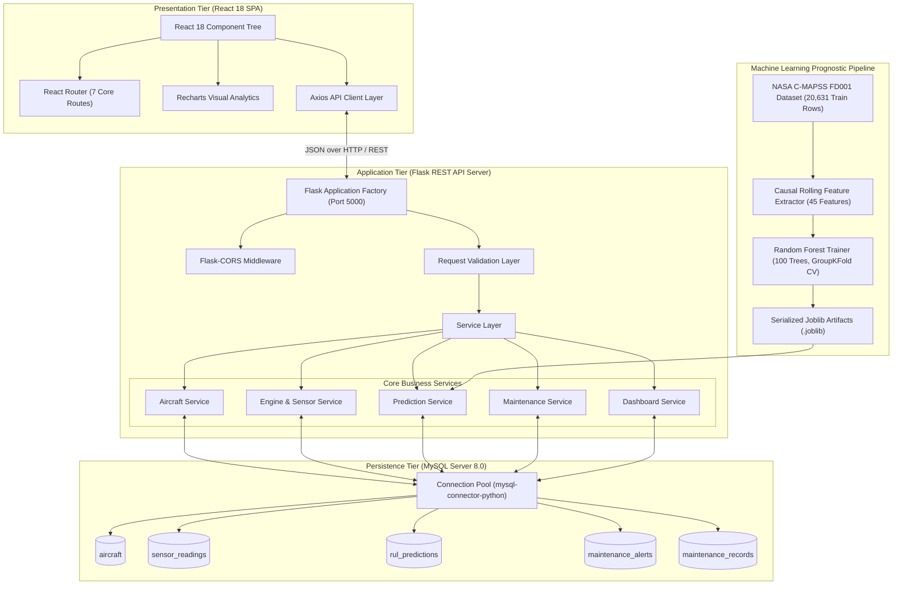
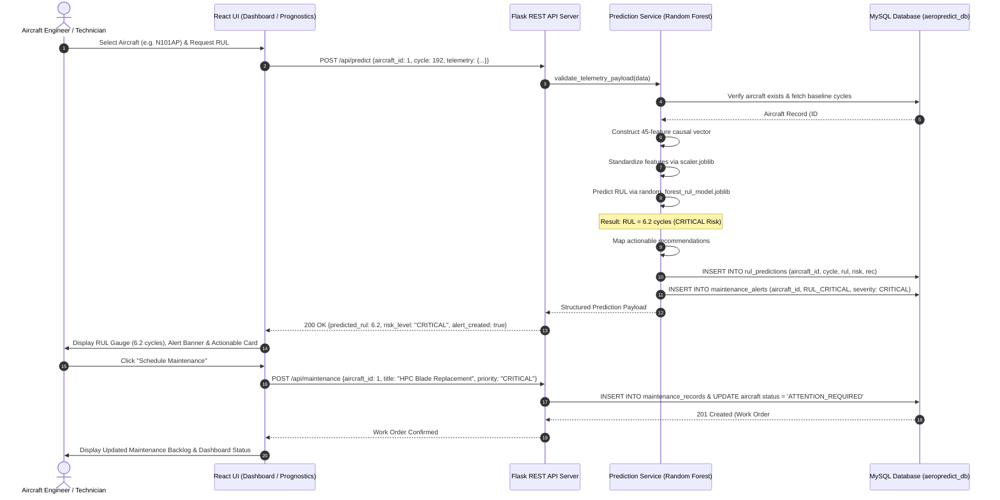

# AeroPredict - System Architecture Document

## 1. High-Level Architecture Overview

AeroPredict follows an enterprise-grade, decoupled three-tier service-oriented architecture:

1. **Client Presentation Tier (Frontend):** Modern Single Page Application (SPA) built with React 18, Vite, Bootstrap 5, Recharts, and Lucide React icons following the Harbor Blue aviation design language.
2. **Application & Analytics Tier (Backend & ML Engine):** Python Flask REST API server paired with a standalone Scikit-learn Machine Learning Prediction Service.
3. **Data Persistence Tier (Database):** MySQL Server 8.0 relational database storing airframe configurations, continuous 21-sensor C-MAPSS telemetry, RUL predictions, active alerts, and work orders.

---

## 2. Component Architecture Details

### 2.1 Frontend Architecture (`frontend/src/`)
Constructed as a modular, responsive Single Page Application (SPA) with clear separation between state, views, and network transports:

- **Client-Side Routing (`App.jsx`):**
  - `/`: Executive Fleet Dashboard (KPIs, availability donut, maintenance distribution, health overview, active alerts)
  - `/aircraft`: Fleet Inventory Management (List, search, filter, status toggles)
  - `/aircraft/add`: Aircraft Registration Form with full field validations
  - `/aircraft/:id`: Aircraft Diagnostics Profile & Edit Form
  - `/monitoring`: Engine Health Monitoring & Sensor Analytics (`?unit=X&tail=Y`)
  - `/predictive`: Predictive Maintenance & RUL Inference (`?id=X&tail=Y`)
  - `/maintenance`: Maintenance Work Order Management & Backlog (`?aircraft_id=X`)
- **API Client Layer (`src/api/`):**
  - `apiClient.js`: Central Axios instance with base URL `http://localhost:5000/api`, 8000ms timeout, and error response unpacker.
  - `aircraftApi.js`, `engineApi.js`, `predictionApi.js`, `maintenanceApi.js`, `dashboardApi.js`: Individual domain clients with seamless fallback to cached local datasets if backend is offline.
- **Visual Analytics (`Recharts`):**
  - Multi-sensor wear degradation curves (T30, T50, P30, Nc, BPR)
  - Fleet Operational Availability Donut Chart (`PieChart`, `Pie`, `Cell`)
  - Maintenance Work Order Distribution Bar Chart (`BarChart`, `Bar`)
- **UI Components (`src/components/`):**
  - `Navbar.jsx`, `Sidebar.jsx`, `MetricCard.jsx`, `StatusBadge.jsx`, `AlertCard.jsx`, `RulGauge.jsx`, `LoadingSpinner.jsx`.

---

### 2.2 Backend Architecture (`backend/`)
Follows Flask's application factory pattern with blueprint modularity and business logic isolation:

- **Application Factory (`app.py`):** Configures app settings, registers all blueprints with centralized URL prefixes, configures CORS, and handles centralized HTTP error codes (400, 404, 405, 500).
- **Database Configuration (`config/database.py`):** Initializes MySQL connection pool (`mysql.connector.pooling.MySQLConnectionPool`) with pool size of 5, providing thread-safe connection reuse, automatic schema creation, and health check utilities.
- **REST Blueprints (`routes/`):**
  - `health_routes.py`: System diagnostic health check (`GET /api/health`).
  - `aircraft_routes.py`: Airframe CRUD operations (`/api/aircraft`).
  - `engine_routes.py`: NASA C-MAPSS sensor readings, historical curves, cycle advancement (`/api/aircraft/<id>/sensors`, `/api/engine`).
  - `prediction_routes.py`: Random Forest RUL inference (`POST /api/predict`), prediction history, model metadata.
  - `maintenance_routes.py`: Work order lifecycle management (`/api/maintenance`).
  - `dashboard_routes.py`: Aggregated executive metrics (`GET /api/dashboard`).
- **Service Layer (`services/`):**
  - `aircraft_service.py`: Fleet asset logic, validations, cascade deletes.
  - `engine_service.py`: Sensor history extraction, cycle advance wear simulation, 7 subsystem diagnostic scoring.
  - `prediction_service.py`: Singleton ML inference engine, physical sensor boundary validation, 45 rolling feature vector construction, RUL inference, risk tiering, recommendation mapping, MySQL alert creation.
  - `maintenance_service.py`: Work order creation, status lifecycle transitions (`PENDING` $\rightarrow$ `IN_PROGRESS` $\rightarrow$ `COMPLETED`), automatic airframe status realignment.
  - `dashboard_service.py`: Aggregated KPI calculations, fleet health scoring, alert feeds.

---

### 2.3 Machine Learning Architecture (`ml_model/`)

```mermaid
flowchart LR
    A["Raw C-MAPSS Data\n(train_FD001.txt)"] --> B["Drop 7 Invariant Sensors\n(std = 0)"]
    B --> C["Piecewise RUL Capping\n(Max RUL = 125 cycles)"]
    C --> D["Feature Engineering\n(45 Causal Rolling Features)"]
    D --> E["StandardScaler\n(Zero Data Leakage)"]
    E --> F["5-Fold GroupKFold CV\n(Split by Engine Unit ID)"]
    F --> G["Random Forest Regressor\n(100 Trees, Depth 18)"]
    G --> H["Evaluate Test Set\n(100 Engines, RUL_FD001.txt)"]
    H --> I["Export Serialized Artifacts\n(.joblib & .json)"]
```

- **Data Ingestion:** Reads space-delimited NASA C-MAPSS FD001 matrix (100 training engines, 100 test engines).
- **Variance Filtering:** Drops 7 invariant sensor channels with zero variance across all cycles (`sensor_1`, `sensor_5`, `sensor_6`, `sensor_10`, `sensor_16`, `sensor_18`, `sensor_19`).
- **Piecewise Linear Target Formulation:** Caps Remaining Useful Life at 125 cycles during early operating stages to reflect negligible thermodynamic degradation before initial micro-wear onset.
- **Causal Feature Engineering:** Generates 45 features including elapsed cycles, operational settings, 14 active sensors, 14 rolling means (window $W=5$), and 14 rolling standard deviations (window $W=5$).
- **Zero-Leakage GroupKFold CV:** Splits training set into 5 folds strictly grouped by `unit_number` so an engine's earlier cycles never appear in both training and validation splits.
- **Model Training:** `RandomForestRegressor(n_estimators=100, max_depth=18, min_samples_split=5, min_samples_leaf=2, max_features=0.7, random_state=42)`.
- **Inference Runtime:** Pre-loads serialized model and scaler once on startup. Evaluates RUL in $<30\text{ ms}$ without retraining during requests.

---

## 3. End-to-End Prediction & Maintenance Sequence Diagram

