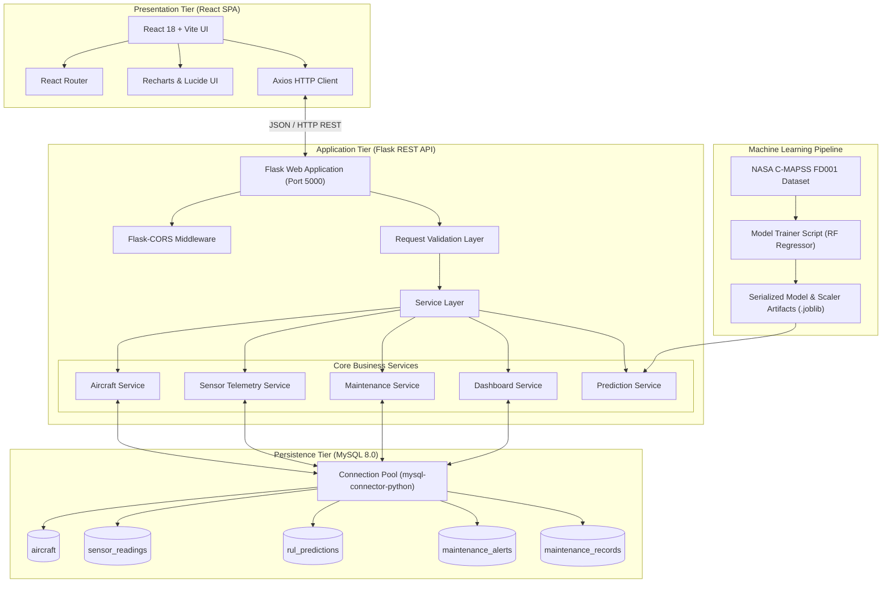
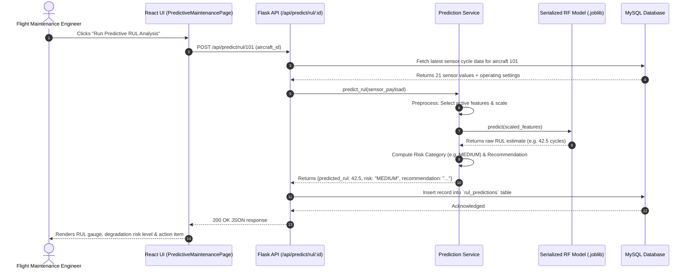

# AeroPredict - System Architecture Document

## 1. High-Level Architecture Overview

AeroPredict follows a decoupled, three-tier service-oriented architecture:
1. **Client Presentation Tier (Frontend):** Modern Single Page Application (SPA) built with React and Vite.
2. **Application & Analytics Tier (Backend & ML Engine):** Python Flask REST API server paired with a standalone Scikit-learn Machine Learning Prediction Service.
3. **Data Persistence Tier (Database):** Relational database powered by MySQL Server storing aircraft specifications, simulated telemetry streams, predictions, and maintenance records.



---

## 2. Component Architecture Details

### 2.1 Frontend Architecture (`frontend/`)
The frontend is constructed as an asynchronous React Single Page Application initialized via Vite.

- **Routing:** Handled declaratively with `react-router-dom`:
  - `/` -> Dashboard
  - `/aircraft` -> Aircraft Fleet Management (List, Add, Edit, Delete)
  - `/aircraft/:id/monitoring` -> Engine Health Monitoring & Sensor Analytics
  - `/aircraft/:id/predict` -> Predictive Maintenance & RUL Inference
  - `/maintenance` -> Maintenance Work Orders & History
- **API Communication:** Dedicated service layer (`api/` directory) wrapping Axios instances with base URL configurations, global error handling, and request timeouts.
- **Visual Analytics:** `recharts` for interactive real-time multi-sensor telemetry graphs (ResponsiveContainer, LineChart, Tooltip, CartesianGrid, Legend).
- **Styling:** Bootstrap 5 for grid layout, responsive typography, cards, and navigation headers, augmented with Lucide React icons.

### 2.2 Backend Architecture (`backend/`)
The backend is structured using Flask application factory and blueprint patterns to ensure clean separation of concerns and maintainability.

- **Entry Point (`backend/app.py`):** Configures app settings, registers blueprints, sets up CORS, and verifies database connectivity.
- **Database Module (`backend/db/`):** Implements connection pooling (`mysql.connector.pooling`) to efficiently manage database connections, prevent connection leaks, and provide transaction management.
- **Controllers / Routes (`backend/routes/`):**
  - `aircraft_routes.py`: CRUD endpoints for aircraft assets.
  - `sensor_routes.py`: Endpoints for current readings, historical sensor records, and cycle simulation.
  - `prediction_routes.py`: Inference trigger endpoints passing sensor data to the ML prediction service.
  - `maintenance_routes.py`: Work order lifecycle management.
  - `dashboard_routes.py`: Aggregated operational metrics.
- **Services (`backend/services/`):** Business logic separated from HTTP transport, facilitating testing and reusability.

### 2.3 Machine Learning Pipeline Architecture (`ml_model/`)
- **Training Pipeline (`ml_model/train.py`):**
  - Ingests `train_FD001.txt`, `test_FD001.txt`, and `RUL_FD001.txt`.
  - Computes ground-truth RUL for training engines ($RUL = max\_cycle - current\_cycle$, clipped at piecewise maximum $RUL_{max} = 125$).
  - Discards invariant sensors that carry zero variance in FD001 (e.g. Sensors 1, 5, 6, 10, 16, 18, 19, and Setting 3).
  - Normalizes feature vectors using `StandardScaler` fitted strictly on training engines.
  - Trains a `RandomForestRegressor` with cross-validation partitioned strictly by **Engine Unit ID** (GroupKFold) to prevent temporal data leakage.
  - Evaluates performance against the official test set using MAE and RMSE metrics.
  - Persists artifacts (`random_forest_rul_model.joblib`, `scaler.joblib`, `feature_names.joblib`) into `ml_model/artifacts/`.
- **Prediction Service (`backend/services/prediction_service.py`):**
  - Loads serialized artifacts once during backend startup (lazy-singleton pattern).
  - Validates feature schema and ordering for incoming sensor payloads.
  - Transforms raw readings through saved scaler.
  - Computes predicted RUL, maps RUL to risk level (`LOW`, `MEDIUM`, `HIGH`, `CRITICAL`), and generates actionable engineering recommendations.

---

## 3. Comprehensive Project Folder Structure

```
d:/Aeropredict/
│
├── dataset/                               # NASA C-MAPSS raw data files
│   ├── train_FD001.txt
│   ├── test_FD001.txt
│   ├── RUL_FD001.txt
│   └── readme.txt
│
├── ml_model/                              # Offline ML modeling & serialization
│   ├── artifacts/                         # Serialized models and scalers
│   │   ├── random_forest_rul_model.joblib
│   │   ├── scaler.joblib
│   │   └── feature_names.joblib
│   ├── __init__.py
│   ├── data_loader.py                     # C-MAPSS dataset parser & cleaner
│   ├── feature_engineering.py             # Feature selection, scaling & RUL targets
│   ├── train.py                           # Training, GroupKFold validation, test eval
│   └── evaluate.py                        # Model metrics (MAE, RMSE, R2, Error plots)
│
├── backend/                               # Flask REST API service
│   ├── config.py                          # DB config, model paths, environment vars
│   ├── app.py                             # Flask app factory & server runner
│   ├── requirements.txt                   # Backend Python dependencies
│   ├── db/
│   │   ├── __init__.py
│   │   ├── connection.py                  # MySQL connection pooling & cursor helpers
│   │   └── schema.sql                     # DDL table creation & initial seed script
│   ├── routes/
│   │   ├── __init__.py
│   │   ├── aircraft_routes.py             # Fleet CRUD API
│   │   ├── sensor_routes.py               # Telemetry and sensor history API
│   │   ├── prediction_routes.py           # RUL inference API
│   │   ├── maintenance_routes.py          # Work orders & task status API
│   │   └── dashboard_routes.py            # Overview statistics API
│   ├── services/
│   │   ├── __init__.py
│   │   ├── aircraft_service.py            # Fleet business logic
│   │   ├── sensor_service.py              # Sensor querying & simulation logic
│   │   ├── prediction_service.py          # Model inference wrapper
│   │   ├── maintenance_service.py         # Maintenance lifecycle logic
│   │   └── dashboard_service.py           # KPI calculation logic
│   └── tests/
│       ├── test_db_connection.py          # MySQL health check test
│       ├── test_api_endpoints.py          # Flask test client unit/integration tests
│       └── test_prediction_service.py      # ML inference test with sample sensor input
│
├── frontend/                              # React.js Vite Single Page Application
│   ├── package.json
│   ├── vite.config.js
│   ├── index.html
│   └── src/
│       ├── main.jsx                       # React entry point
│       ├── App.jsx                        # Root component with Router navigation
│       ├── index.css                      # Global styles and custom overrides
│       ├── api/                           # Axios API service clients
│       │   ├── apiClient.js               # Axios instance with base URL & interceptors
│       │   ├── aircraftApi.js
│       │   ├── sensorApi.js
│       │   ├── predictionApi.js
│       │   ├── maintenanceApi.js
│       │   └── dashboardApi.js
│       ├── components/                    # Reusable UI widgets
│       │   ├── Navbar.jsx                 # Top navigation bar
│       │   ├── Sidebar.jsx                # Navigation menu
│       │   ├── StatusBadge.jsx            # Risk and operational status pill
│       │   ├── LoadingSpinner.jsx         # Loading state indicator
│       │   └── ErrorAlert.jsx             # User error notification card
│       └── pages/                         # Core module pages
│           ├── DashboardPage.jsx          # Module 1: Executive Dashboard
│           ├── AircraftListPage.jsx       # Module 2: Fleet Management (List/Search)
│           ├── AircraftFormModal.jsx      # Module 2: Add/Edit Modal
│           ├── EngineMonitoringPage.jsx   # Module 3: Sensor charts & simulation
│           ├── PredictiveMaintenancePage.jsx # Module 4: RUL inference & risk
│           └── MaintenancePage.jsx        # Module 5: Work order management
│
├── documentation/                         # Project reports and documentation
│   ├── PROJECT_SPEC.md                    # Core project specifications
│   ├── ARCHITECTURE.md                    # System architecture design (this document)
│   ├── DATABASE_SCHEMA.md                 # Database schema & ER diagrams
│   ├── IMPLEMENTATION_PLAN.md             # Development milestones & roadmap
│   └── PROGRESS.md                        # Milestone completion tracker
│
├── README.md                              # Project setup and user guide
└── .gitignore                             # Ignored paths (node_modules, venv, cache)
```

---

## 4. End-to-End Prediction Sequence Diagram


