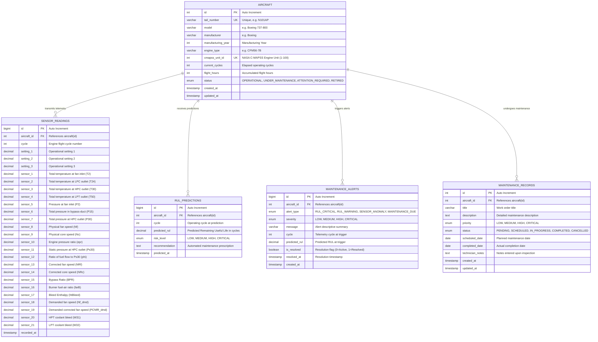

# AeroPredict - Database Schema Document

## 1. Database Overview
- **Database Engine:** MySQL Server 8.0+
- **Default Database Name:** `aeropredict_db`
- **Character Set:** `utf8mb4`
- **Collation:** `utf8mb4_unicode_ci`
- **Storage Engine:** InnoDB (Supports ACID transactions, Foreign Key constraints, row-level locking, and connection pooling)

---

## 2. Entity-Relationship (ER) Diagram



---

## 3. Detailed Table Specifications

### 3.1 Table: `aircraft`
Stores metadata and operational status for all managed airframes in the fleet.

| Column Name | Data Type | Nullable | Default | Description & Constraints |
| :--- | :--- | :--- | :--- | :--- |
| `id` | INT | NO | Auto Increment | Primary Key. |
| `tail_number` | VARCHAR(20) | NO | None | Unique registration identifier (e.g. `N101AP`, `VT-AER`). UNIQUE INDEX. |
| `model` | VARCHAR(50) | NO | None | Airframe model (e.g. `Boeing 737-800`, `Airbus A320neo`). |
| `manufacturer` | VARCHAR(50) | NO | None | Manufacturer name (e.g. `Boeing`, `Airbus`, `Embraer`). |
| `manufacturing_year` | INT | YES | NULL | Aircraft year of manufacture. |
| `engine_type` | VARCHAR(50) | NO | None | Turbofan engine model (e.g. `CFM56-7B`, `CFM LEAP-1A`, `GE90-115B`). |
| `cmapss_unit_id` | INT | YES | NULL | Mapped NASA C-MAPSS FD001 engine unit identifier (1–100). UNIQUE INDEX. |
| `current_cycles` | INT | NO | 0 | Current operating flight cycles accrued. |
| `flight_hours` | INT | NO | 0 | Total flight hours logged. |
| `status` | ENUM | NO | `OPERATIONAL` | `OPERATIONAL`, `UNDER_MAINTENANCE`, `ATTENTION_REQUIRED`, `RETIRED`. INDEX. |
| `created_at` | TIMESTAMP | NO | `CURRENT_TIMESTAMP` | Record creation timestamp. |
| `updated_at` | TIMESTAMP | NO | `CURRENT_TIMESTAMP ON UPDATE CURRENT_TIMESTAMP` | Last updated timestamp. |

---

### 3.2 Table: `sensor_readings`
High-resolution time-series sensor telemetry table containing NASA C-MAPSS 21-channel physical sensor measurements and 3 operational settings.

| Column Name | Data Type | Nullable | Default | Description |
| :--- | :--- | :--- | :--- | :--- |
| `id` | BIGINT | NO | Auto Increment | Primary Key. |
| `aircraft_id` | INT | NO | None | Foreign Key referencing `aircraft(id)` with `ON DELETE CASCADE`. INDEX. |
| `cycle` | INT | NO | None | Operating flight cycle number. INDEX. |
| `setting_1` | DECIMAL(8,4) | NO | None | Altitude / Mach setting parameter 1. |
| `setting_2` | DECIMAL(8,4) | NO | None | Throttle resolver angle setting parameter 2. |
| `setting_3` | DECIMAL(8,2) | NO | None | Environmental setting parameter 3 (100.0 for Sea Level). |
| `sensor_1` to `sensor_21` | DECIMAL(10,4) | NO | None | 21 continuous sensor channels corresponding to C-MAPSS parameters. |
| `recorded_at` | TIMESTAMP | NO | `CURRENT_TIMESTAMP` | Telemetry capture timestamp. |

**Composite Index:** `idx_aircraft_cycle (aircraft_id, cycle)` for rapid historical degradation trajectory queries.

---

### 3.3 Table: `rul_predictions`
Persists model inferences, predicted flight cycles, estimated confidence, and automated recommendations.

| Column Name | Data Type | Nullable | Default | Description |
| :--- | :--- | :--- | :--- | :--- |
| `id` | BIGINT | NO | Auto Increment | Primary Key. |
| `aircraft_id` | INT | NO | None | Foreign Key referencing `aircraft(id)` with `ON DELETE CASCADE`. INDEX. |
| `cycle` | INT | NO | None | Operating cycle at which inference was executed. |
| `predicted_rul` | DECIMAL(8,2) | NO | None | Inferred Remaining Useful Life in flight cycles. |
| `risk_level` | ENUM | NO | None | `LOW`, `MEDIUM`, `HIGH`, `CRITICAL`. |
| `recommendation` | TEXT | NO | None | Contextual maintenance prescription generated by prediction service. |
| `predicted_at` | TIMESTAMP | NO | `CURRENT_TIMESTAMP` | Inference timestamp. INDEX. |

---

### 3.4 Table: `maintenance_alerts`
Tracks active threshold violations, critical prognostic warnings, and maintenance notifications.

| Column Name | Data Type | Nullable | Default | Description |
| :--- | :--- | :--- | :--- | :--- |
| `id` | BIGINT | NO | Auto Increment | Primary Key. |
| `aircraft_id` | INT | NO | None | Foreign Key referencing `aircraft(id)` with `ON DELETE CASCADE`. INDEX. |
| `alert_type` | ENUM | NO | None | `RUL_CRITICAL`, `RUL_WARNING`, `SENSOR_ANOMALY`, `MAINTENANCE_DUE`. |
| `severity` | ENUM | NO | `MEDIUM` | `LOW`, `MEDIUM`, `HIGH`, `CRITICAL`. |
| `message` | VARCHAR(255) | NO | None | Descriptive summary of the condition. |
| `cycle` | INT | YES | NULL | Telemetry cycle when condition triggered. |
| `predicted_rul` | DECIMAL(8,2) | YES | NULL | Estimated RUL at time of trigger. |
| `is_resolved` | TINYINT(1) | NO | 0 | 0 = Unresolved/Active, 1 = Acknowledged/Resolved. INDEX. |
| `resolved_at` | TIMESTAMP | YES | NULL | Resolution timestamp. |
| `created_at` | TIMESTAMP | NO | `CURRENT_TIMESTAMP` | Notification logged timestamp. |

---

### 3.5 Table: `maintenance_records`
Manages work orders, technicians assignments, inspection scopes, and maintenance statuses.

| Column Name | Data Type | Nullable | Default | Description |
| :--- | :--- | :--- | :--- | :--- |
| `id` | INT | NO | Auto Increment | Primary Key. |
| `aircraft_id` | INT | NO | None | Foreign Key referencing `aircraft(id)` with `ON DELETE CASCADE`. INDEX. |
| `title` | VARCHAR(150) | NO | None | Work order title / inspection scope. |
| `description` | TEXT | YES | NULL | Detailed notes, findings, or technician instructions. |
| `priority` | ENUM | NO | `MEDIUM` | `LOW`, `MEDIUM`, `HIGH`, `CRITICAL`. |
| `status` | ENUM | NO | `PENDING` | `PENDING`, `SCHEDULED`, `IN_PROGRESS`, `COMPLETED`, `CANCELLED`. INDEX. |
| `scheduled_date` | DATE | NO | None | Planned maintenance execution date. |
| `completed_date` | DATE | YES | NULL | Actual completion date. |
| `technician_notes` | TEXT | YES | NULL | Technical findings entered post-maintenance. |
| `created_at` | TIMESTAMP | NO | `CURRENT_TIMESTAMP` | Record creation timestamp. |
| `updated_at` | TIMESTAMP | NO | `CURRENT_TIMESTAMP ON UPDATE CURRENT_TIMESTAMP` | Work order update timestamp. |

---

## 4. DDL Creation Script (Production DDL)

```sql
-- Create Database
CREATE DATABASE IF NOT EXISTS aeropredict_db
CHARACTER SET utf8mb4
COLLATE utf8mb4_unicode_ci;

USE aeropredict_db;

-- 1. Aircraft Table
CREATE TABLE IF NOT EXISTS aircraft (
    id INT AUTO_INCREMENT PRIMARY KEY,
    tail_number VARCHAR(20) NOT NULL UNIQUE,
    model VARCHAR(50) NOT NULL,
    manufacturer VARCHAR(50) NOT NULL,
    manufacturing_year INT NULL,
    engine_type VARCHAR(50) NOT NULL,
    cmapss_unit_id INT NULL UNIQUE,
    current_cycles INT NOT NULL DEFAULT 0,
    flight_hours INT NOT NULL DEFAULT 0,
    status ENUM('OPERATIONAL', 'UNDER_MAINTENANCE', 'ATTENTION_REQUIRED', 'RETIRED') NOT NULL DEFAULT 'OPERATIONAL',
    created_at TIMESTAMP DEFAULT CURRENT_TIMESTAMP,
    updated_at TIMESTAMP DEFAULT CURRENT_TIMESTAMP ON UPDATE CURRENT_TIMESTAMP,
    INDEX idx_aircraft_status (status),
    INDEX idx_aircraft_tail (tail_number)
) ENGINE=InnoDB;

-- 2. Sensor Readings Table
CREATE TABLE IF NOT EXISTS sensor_readings (
    id BIGINT AUTO_INCREMENT PRIMARY KEY,
    aircraft_id INT NOT NULL,
    cycle INT NOT NULL,
    setting_1 DECIMAL(8,4) NOT NULL,
    setting_2 DECIMAL(8,4) NOT NULL,
    setting_3 DECIMAL(8,2) NOT NULL,
    sensor_1 DECIMAL(10,4) NOT NULL,
    sensor_2 DECIMAL(10,4) NOT NULL,
    sensor_3 DECIMAL(10,4) NOT NULL,
    sensor_4 DECIMAL(10,4) NOT NULL,
    sensor_5 DECIMAL(10,4) NOT NULL,
    sensor_6 DECIMAL(10,4) NOT NULL,
    sensor_7 DECIMAL(10,4) NOT NULL,
    sensor_8 DECIMAL(10,4) NOT NULL,
    sensor_9 DECIMAL(10,4) NOT NULL,
    sensor_10 DECIMAL(10,4) NOT NULL,
    sensor_11 DECIMAL(10,4) NOT NULL,
    sensor_12 DECIMAL(10,4) NOT NULL,
    sensor_13 DECIMAL(10,4) NOT NULL,
    sensor_14 DECIMAL(10,4) NOT NULL,
    sensor_15 DECIMAL(10,4) NOT NULL,
    sensor_16 DECIMAL(10,4) NOT NULL,
    sensor_17 DECIMAL(10,4) NOT NULL,
    sensor_18 DECIMAL(10,4) NOT NULL,
    sensor_19 DECIMAL(10,4) NOT NULL,
    sensor_20 DECIMAL(10,4) NOT NULL,
    sensor_21 DECIMAL(10,4) NOT NULL,
    recorded_at TIMESTAMP DEFAULT CURRENT_TIMESTAMP,
    FOREIGN KEY (aircraft_id) REFERENCES aircraft(id) ON DELETE CASCADE,
    INDEX idx_sensor_aircraft (aircraft_id),
    INDEX idx_sensor_cycle (cycle),
    INDEX idx_aircraft_cycle (aircraft_id, cycle)
) ENGINE=InnoDB;

-- 3. Maintenance Alerts Table
CREATE TABLE IF NOT EXISTS maintenance_alerts (
    id BIGINT AUTO_INCREMENT PRIMARY KEY,
    aircraft_id INT NOT NULL,
    alert_type ENUM('RUL_CRITICAL', 'RUL_WARNING', 'SENSOR_ANOMALY', 'MAINTENANCE_DUE') NOT NULL,
    severity ENUM('LOW', 'MEDIUM', 'HIGH', 'CRITICAL') NOT NULL DEFAULT 'MEDIUM',
    message VARCHAR(255) NOT NULL,
    cycle INT NULL,
    predicted_rul DECIMAL(8,2) NULL,
    is_resolved TINYINT(1) NOT NULL DEFAULT 0,
    resolved_at TIMESTAMP NULL,
    created_at TIMESTAMP DEFAULT CURRENT_TIMESTAMP,
    FOREIGN KEY (aircraft_id) REFERENCES aircraft(id) ON DELETE CASCADE,
    INDEX idx_alert_aircraft (aircraft_id),
    INDEX idx_alert_status (is_resolved),
    INDEX idx_alert_severity (severity)
) ENGINE=InnoDB;

-- 4. Maintenance Records Table
CREATE TABLE IF NOT EXISTS maintenance_records (
    id INT AUTO_INCREMENT PRIMARY KEY,
    aircraft_id INT NOT NULL,
    title VARCHAR(150) NOT NULL,
    description TEXT NULL,
    priority ENUM('LOW', 'MEDIUM', 'HIGH', 'CRITICAL') NOT NULL DEFAULT 'MEDIUM',
    status ENUM('PENDING', 'SCHEDULED', 'IN_PROGRESS', 'COMPLETED', 'CANCELLED') NOT NULL DEFAULT 'PENDING',
    scheduled_date DATE NOT NULL,
    completed_date DATE NULL,
    technician_notes TEXT NULL,
    created_at TIMESTAMP DEFAULT CURRENT_TIMESTAMP,
    updated_at TIMESTAMP DEFAULT CURRENT_TIMESTAMP ON UPDATE CURRENT_TIMESTAMP,
    FOREIGN KEY (aircraft_id) REFERENCES aircraft(id) ON DELETE CASCADE,
    INDEX idx_maint_aircraft (aircraft_id),
    INDEX idx_maint_status (status),
    INDEX idx_maint_priority (priority)
) ENGINE=InnoDB;

-- 5. RUL Predictions Table
CREATE TABLE IF NOT EXISTS rul_predictions (
    id BIGINT AUTO_INCREMENT PRIMARY KEY,
    aircraft_id INT NOT NULL,
    cycle INT NOT NULL,
    predicted_rul DECIMAL(8,2) NOT NULL,
    risk_level ENUM('LOW', 'MEDIUM', 'HIGH', 'CRITICAL') NOT NULL,
    recommendation TEXT NOT NULL,
    predicted_at TIMESTAMP DEFAULT CURRENT_TIMESTAMP,
    FOREIGN KEY (aircraft_id) REFERENCES aircraft(id) ON DELETE CASCADE,
    INDEX idx_pred_aircraft (aircraft_id),
    INDEX idx_pred_cycle (cycle),
    INDEX idx_pred_date (predicted_at)
) ENGINE=InnoDB;
```

---

## 5. Referential Integrity & Relational Verification

As verified in the **Phase 12 Database Audit** ([`db_audit.py`](file:///d:/Aeropredict/backend/tests/db_audit.py)):
- **Primary Keys:** Explicitly defined on all tables.
- **Foreign Key Constraints:** 4 active foreign keys referencing `aircraft.id`.
- **Orphan Records:** 0 across all tables.
- **Duplicate Records:** 0 duplicate tail numbers, 0 duplicate unit IDs.
- **Mandatory NOT NULL Violations:** 0 across all tables.
