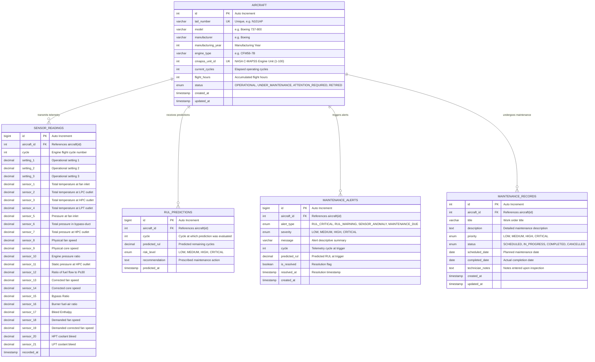

# AeroPredict - Database Schema Document

## 1. Database Overview
- **Database Engine:** MySQL Server 8.0+
- **Default Database Name:** `aeropredict_db`
- **Character Set:** `utf8mb4`
- **Collation:** `utf8mb4_unicode_ci`
- **Storage Engine:** InnoDB (Supports ACID transactions, Foreign Key constraints, and row-level locking)

---

## 2. Entity-Relationship (ER) Diagram



---

## 3. Detailed Table Specifications

### 3.1 Table: `aircraft`
Stores metadata and operational status for all managed aircraft in the fleet.

| Column Name | Data Type | Nullable | Default | Description & Constraints |
| :--- | :--- | :--- | :--- | :--- |
| `id` | INT | NO | Auto Increment | Primary Key. |
| `tail_number` | VARCHAR(20) | NO | None | Unique registration identifier (e.g. `N101AP`, `VT-AER`). UNIQUE INDEX. |
| `model` | VARCHAR(50) | NO | None | Commercial aircraft model (e.g. `Boeing 737-800`, `Airbus A320neo`). |
| `manufacturer` | VARCHAR(50) | NO | None | Aircraft OEM (e.g. `Boeing`, `Airbus`, `Embraer`). |
| `manufacturing_year` | INT | YES | NULL | Manufacturing year of the airframe (e.g. 2018). |
| `engine_type` | VARCHAR(50) | NO | None | Jet engine model (e.g. `CFM56-7B`, `LEAP-1A`, `PW1100G`). |
| `cmapss_unit_id` | INT | YES | NULL | Link to simulated C-MAPSS dataset engine unit (1–100). UNIQUE. |
| `current_cycles` | INT | NO | 0 | Accumulated flight cycles since last engine overhaul. |
| `flight_hours` | INT | NO | 0 | Accumulated operating flight hours. |
| `status` | ENUM | NO | 'OPERATIONAL' | Operational status: `'OPERATIONAL'`, `'UNDER_MAINTENANCE'`, `'ATTENTION_REQUIRED'`, `'RETIRED'`. |
| `created_at` | TIMESTAMP | NO | CURRENT_TIMESTAMP | Record creation timestamp. |
| `updated_at` | TIMESTAMP | NO | CURRENT_TIMESTAMP ON UPDATE | Last update timestamp. |

---

### 3.2 Table: `sensor_readings`
Stores continuous time-series telemetry for each aircraft's engine cycles. (Corresponds to the 21 continuous sensor channels and 3 operational settings in NASA C-MAPSS FD001).

| Column Name | Data Type | Nullable | Default | Description |
| :--- | :--- | :--- | :--- | :--- |
| `id` | BIGINT | NO | Auto Increment | Primary Key. |
| `aircraft_id` | INT | NO | None | Foreign Key referencing `aircraft(id)` ON DELETE CASCADE. |
| `cycle` | INT | NO | None | Flight cycle index for this telemetry reading. |
| `setting_1` | DECIMAL(10,4) | YES | NULL | Operational setting 1 (Altitude / throttle). |
| `setting_2` | DECIMAL(10,4) | YES | NULL | Operational setting 2 (Mach number). |
| `setting_3` | DECIMAL(10,4) | YES | NULL | Operational setting 3 (TRA). |
| `sensor_1` to `sensor_21` | DECIMAL(12,4) | YES | NULL | 21 thermodynamic and aerodynamic sensor readings. |
| `recorded_at` | TIMESTAMP | NO | CURRENT_TIMESTAMP | Ingestion timestamp. |

- **Indexes:**
  - `idx_sensor_aircraft_cycle` on `(aircraft_id, cycle DESC)`: Optimizes retrieval of the latest cycle and historical window queries.

---

### 3.3 Table: `maintenance_alerts`
Stores active and historical maintenance alerts generated by the RUL predictive threshold engine or sensor anomalies. Directly feeds the Executive Dashboard recent alert widget.

| Column Name | Data Type | Nullable | Default | Description |
| :--- | :--- | :--- | :--- | :--- |
| `id` | BIGINT | NO | Auto Increment | Primary Key. |
| `aircraft_id` | INT | NO | None | Foreign Key referencing `aircraft(id)` ON DELETE CASCADE. |
| `alert_type` | ENUM | NO | None | Alert category: `'RUL_CRITICAL'`, `'RUL_WARNING'`, `'SENSOR_ANOMALY'`, `'MAINTENANCE_DUE'`. |
| `severity` | ENUM | NO | 'MEDIUM' | Alert severity: `'LOW'`, `'MEDIUM'`, `'HIGH'`, `'CRITICAL'`. |
| `message` | VARCHAR(255) | NO | None | Human-readable explanation and trigger reason. |
| `cycle` | INT | YES | NULL | Engine cycle at which alert was triggered. |
| `predicted_rul` | DECIMAL(8,2) | YES | NULL | Predicted RUL at trigger (if RUL-derived). |
| `is_resolved` | BOOLEAN | NO | FALSE | Resolution flag (false = active, true = resolved). |
| `resolved_at` | TIMESTAMP | YES | NULL | Timestamp when alert was acknowledged / resolved. |
| `created_at` | TIMESTAMP | NO | CURRENT_TIMESTAMP | Alert trigger timestamp. |

- **Indexes:**
  - `idx_alerts_aircraft` on `(aircraft_id)`: Rapid lookup of alerts for a specific aircraft.
  - `idx_alerts_active_severity` on `(is_resolved, severity)`: Fast retrieval of active critical alerts for the dashboard.

---

### 3.4 Table: `rul_predictions`
Stores raw outputs generated by the Random Forest Regressor for historical auditing and drift monitoring.

| Column Name | Data Type | Nullable | Default | Description |
| :--- | :--- | :--- | :--- | :--- |
| `id` | BIGINT | NO | Auto Increment | Primary Key. |
| `aircraft_id` | INT | NO | None | Foreign Key referencing `aircraft(id)` ON DELETE CASCADE. |
| `cycle` | INT | NO | None | Engine cycle at the time the prediction was executed. |
| `predicted_rul` | DECIMAL(8,2) | NO | None | Estimated remaining flight cycles before failure. |
| `risk_level` | ENUM | NO | None | Risk classification: `'LOW'`, `'MEDIUM'`, `'HIGH'`, `'CRITICAL'`. |
| `recommendation` | TEXT | NO | None | Maintenance recommendation generated based on risk. |
| `predicted_at` | TIMESTAMP | NO | CURRENT_TIMESTAMP | Inference execution timestamp. |

- **Indexes:**
  - `idx_prediction_aircraft_time` on `(aircraft_id, predicted_at DESC)`: Rapid retrieval of latest RUL per aircraft.

---

### 3.5 Table: `maintenance_records`
Manages work orders, inspections, overhaul tracking, and technical log notes.

| Column Name | Data Type | Nullable | Default | Description |
| :--- | :--- | :--- | :--- | :--- |
| `id` | INT | NO | Auto Increment | Primary Key. |
| `aircraft_id` | INT | NO | None | Foreign Key referencing `aircraft(id)` ON DELETE CASCADE. |
| `title` | VARCHAR(150) | NO | None | Summary of maintenance action (e.g. `HPC Blade Borescope Inspection`). |
| `description` | TEXT | YES | NULL | Detailed work instructions and failure symptoms. |
| `priority` | ENUM | NO | 'MEDIUM' | Priority: `'LOW'`, `'MEDIUM'`, `'HIGH'`, `'CRITICAL'`. |
| `status` | ENUM | NO | 'SCHEDULED' | Status: `'SCHEDULED'`, `'IN_PROGRESS'`, `'COMPLETED'`, `'CANCELLED'`. |
| `scheduled_date` | DATE | NO | None | Date work order is scheduled for. |
| `completed_date` | DATE | YES | NULL | Date maintenance was finalized. |
| `technician_notes` | TEXT | YES | NULL | Field notes entered by the maintenance engineer. |
| `created_at` | TIMESTAMP | NO | CURRENT_TIMESTAMP | Order creation timestamp. |
| `updated_at` | TIMESTAMP | NO | CURRENT_TIMESTAMP ON UPDATE | Last update timestamp. |

- **Indexes:**
  - `idx_maintenance_aircraft_status` on `(aircraft_id, status)`: Fast filtering of pending actions per aircraft.
  - `idx_maintenance_status_priority` on `(status, priority)`: Dashboard aggregation of critical open tasks.

---

## 4. DDL Script (`schema.sql`)

```sql
-- AeroPredict Database DDL Script
CREATE DATABASE IF NOT EXISTS aeropredict_db
  CHARACTER SET utf8mb4
  COLLATE utf8mb4_unicode_ci;

USE aeropredict_db;

-- 1. Aircraft Table
CREATE TABLE IF NOT EXISTS aircraft (
    id INT AUTO_INCREMENT PRIMARY KEY,
    tail_number VARCHAR(20) NOT NULL UNIQUE,
    model VARCHAR(50) NOT NULL,
    manufacturer VARCHAR(50) NOT NULL,
    manufacturing_year INT NULL,
    engine_type VARCHAR(50) NOT NULL,
    cmapss_unit_id INT UNIQUE NULL,
    current_cycles INT NOT NULL DEFAULT 0,
    flight_hours INT NOT NULL DEFAULT 0,
    status ENUM('OPERATIONAL', 'UNDER_MAINTENANCE', 'ATTENTION_REQUIRED', 'RETIRED') NOT NULL DEFAULT 'OPERATIONAL',
    created_at TIMESTAMP NOT NULL DEFAULT CURRENT_TIMESTAMP,
    updated_at TIMESTAMP NOT NULL DEFAULT CURRENT_TIMESTAMP ON UPDATE CURRENT_TIMESTAMP,
    INDEX idx_aircraft_status (status)
) ENGINE=InnoDB;

-- 2. Sensor Readings Table
CREATE TABLE IF NOT EXISTS sensor_readings (
    id BIGINT AUTO_INCREMENT PRIMARY KEY,
    aircraft_id INT NOT NULL,
    cycle INT NOT NULL,
    setting_1 DECIMAL(10,4) NULL,
    setting_2 DECIMAL(10,4) NULL,
    setting_3 DECIMAL(10,4) NULL,
    sensor_1 DECIMAL(12,4) NULL,
    sensor_2 DECIMAL(12,4) NULL,
    sensor_3 DECIMAL(12,4) NULL,
    sensor_4 DECIMAL(12,4) NULL,
    sensor_5 DECIMAL(12,4) NULL,
    sensor_6 DECIMAL(12,4) NULL,
    sensor_7 DECIMAL(12,4) NULL,
    sensor_8 DECIMAL(12,4) NULL,
    sensor_9 DECIMAL(12,4) NULL,
    sensor_10 DECIMAL(12,4) NULL,
    sensor_11 DECIMAL(12,4) NULL,
    sensor_12 DECIMAL(12,4) NULL,
    sensor_13 DECIMAL(12,4) NULL,
    sensor_14 DECIMAL(12,4) NULL,
    sensor_15 DECIMAL(12,4) NULL,
    sensor_16 DECIMAL(12,4) NULL,
    sensor_17 DECIMAL(12,4) NULL,
    sensor_18 DECIMAL(12,4) NULL,
    sensor_19 DECIMAL(12,4) NULL,
    sensor_20 DECIMAL(12,4) NULL,
    sensor_21 DECIMAL(12,4) NULL,
    recorded_at TIMESTAMP NOT NULL DEFAULT CURRENT_TIMESTAMP,
    FOREIGN KEY (aircraft_id) REFERENCES aircraft(id) ON DELETE CASCADE,
    INDEX idx_sensor_aircraft_cycle (aircraft_id, cycle DESC)
) ENGINE=InnoDB;

-- 3. Maintenance Alerts Table
CREATE TABLE IF NOT EXISTS maintenance_alerts (
    id BIGINT AUTO_INCREMENT PRIMARY KEY,
    aircraft_id INT NOT NULL,
    alert_type ENUM('RUL_CRITICAL', 'RUL_WARNING', 'SENSOR_ANOMALY', 'MAINTENANCE_DUE') NOT NULL,
    severity ENUM('LOW', 'MEDIUM', 'HIGH', 'CRITICAL') NOT NULL DEFAULT 'MEDIUM',
    message VARCHAR(255) NOT NULL,
    cycle INT NULL,
    predicted_rul DECIMAL(8,2) NULL,
    is_resolved BOOLEAN NOT NULL DEFAULT FALSE,
    resolved_at TIMESTAMP NULL,
    created_at TIMESTAMP NOT NULL DEFAULT CURRENT_TIMESTAMP,
    FOREIGN KEY (aircraft_id) REFERENCES aircraft(id) ON DELETE CASCADE,
    INDEX idx_alerts_aircraft (aircraft_id),
    INDEX idx_alerts_active_severity (is_resolved, severity)
) ENGINE=InnoDB;

-- 4. RUL Predictions Table
CREATE TABLE IF NOT EXISTS rul_predictions (
    id BIGINT AUTO_INCREMENT PRIMARY KEY,
    aircraft_id INT NOT NULL,
    cycle INT NOT NULL,
    predicted_rul DECIMAL(8,2) NOT NULL,
    risk_level ENUM('LOW', 'MEDIUM', 'HIGH', 'CRITICAL') NOT NULL,
    recommendation TEXT NOT NULL,
    predicted_at TIMESTAMP NOT NULL DEFAULT CURRENT_TIMESTAMP,
    FOREIGN KEY (aircraft_id) REFERENCES aircraft(id) ON DELETE CASCADE,
    INDEX idx_prediction_aircraft_time (aircraft_id, predicted_at DESC)
) ENGINE=InnoDB;

-- 5. Maintenance Records Table
CREATE TABLE IF NOT EXISTS maintenance_records (
    id INT AUTO_INCREMENT PRIMARY KEY,
    aircraft_id INT NOT NULL,
    title VARCHAR(150) NOT NULL,
    description TEXT NULL,
    priority ENUM('LOW', 'MEDIUM', 'HIGH', 'CRITICAL') NOT NULL DEFAULT 'MEDIUM',
    status ENUM('SCHEDULED', 'IN_PROGRESS', 'COMPLETED', 'CANCELLED') NOT NULL DEFAULT 'SCHEDULED',
    scheduled_date DATE NOT NULL,
    completed_date DATE NULL,
    technician_notes TEXT NULL,
    created_at TIMESTAMP NOT NULL DEFAULT CURRENT_TIMESTAMP,
    updated_at TIMESTAMP NOT NULL DEFAULT CURRENT_TIMESTAMP ON UPDATE CURRENT_TIMESTAMP,
    FOREIGN KEY (aircraft_id) REFERENCES aircraft(id) ON DELETE CASCADE,
    INDEX idx_maintenance_aircraft_status (aircraft_id, status),
    INDEX idx_maintenance_status_priority (status, priority)
) ENGINE=InnoDB;
```
