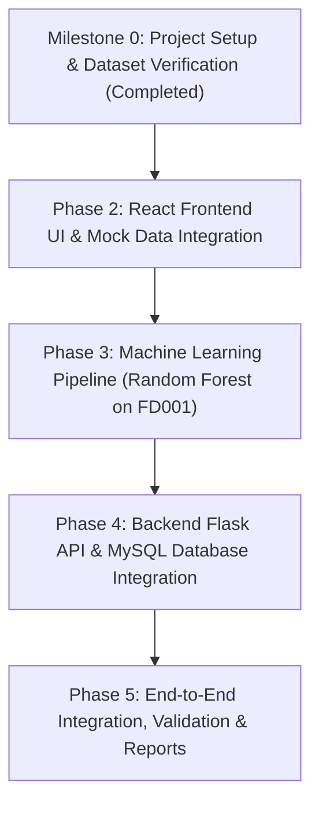

# AeroPredict - Implementation Plan & API Design

## 1. Development Principles & Strategy
In accordance with the project guidelines:
1. **Incremental Milestones:** Only one module is developed and validated at a time.
2. **Strict Verification:** Every endpoint and user-facing feature must be tested before moving forward.
3. **Reproducible Machine Learning:** Train on NASA C-MAPSS FD001 using GroupKFold (split strictly by Engine ID) to prevent data leakage. Test against ground-truth RUL provided in `RUL_FD001.txt`.
4. **No Synthetic Shortcuts:** Rely on actual C-MAPSS FD001 dataset files. Verify file presence before training.

---

## 2. API Design Specification

All responses adhere to a consistent JSON envelope format:
```json
{
  "success": true,
  "data": { ... },
  "message": "Descriptive message"
}
```
Errors return:
```json
{
  "success": false,
  "error": "Error description",
  "details": [ ... ]
}
```

### 2.1 Aircraft Management Endpoints
- `GET /api/aircraft`
  - Query Params: `search` (tail number/model), `status` (filter by status)
  - Response: Array of aircraft objects with latest cycle and status.
- `POST /api/aircraft`
  - Request Body: `{ tail_number, model, manufacturer, engine_type, cmapss_unit_id }`
  - Validation: Unique `tail_number`, valid `cmapss_unit_id` (1-100 or null).
  - Response: Created aircraft object.
- `GET /api/aircraft/:id`
  - Response: Specific aircraft details, associated maintenance history count, and latest sensor cycle.
- `PUT /api/aircraft/:id`
  - Request Body: `{ tail_number, model, manufacturer, engine_type, status, cmapss_unit_id }`
  - Response: Updated aircraft object.
- `DELETE /api/aircraft/:id`
  - Response: Deletion confirmation. Cascades to sensor readings, predictions, and maintenance records.

### 2.2 Engine Health & Telemetry Endpoints
- `GET /api/aircraft/:id/sensors/latest`
  - Response: Latest cycle number, timestamp, and all 21 sensor values plus 3 operational settings.
- `GET /api/aircraft/:id/sensors/history`
  - Query Params: `limit` (default 50, max 200), `sensors` (comma-separated list of sensors, e.g. `sensor_2,sensor_3,sensor_4,sensor_7`)
  - Response: Array of historical cycle readings sorted chronologically for Recharts.
- `POST /api/aircraft/:id/sensors/simulate-cycle`
  - Advances aircraft telemetry by 1 cycle using actual simulated data from the assigned C-MAPSS engine unit.
  - Inserts new reading into `engine_sensor_readings` and increments `aircraft.current_cycles`.
  - Response: The newly ingested sensor reading.

### 2.3 Predictive Maintenance Endpoints
- `POST /api/predict/rul/:id`
  - Computes RUL for the aircraft's current telemetry reading using the trained Random Forest model.
  - Automatically stores the prediction in `rul_predictions`.
  - Response:
    ```json
    {
      "aircraft_id": 1,
      "cycle": 150,
      "predicted_rul": 28.4,
      "risk_level": "HIGH",
      "recommendation": "High degradation observed in High-Pressure Compressor. Schedule immediate borescope inspection.",
      "predicted_at": "2026-11-07T14:30:00Z"
    }
    ```
- `GET /api/predict/history/:id`
  - Response: Past RUL predictions for the aircraft, showing degradation trajectory over time.

### 2.4 Maintenance Management Endpoints
- `GET /api/maintenance`
  - Query Params: `status`, `priority`, `aircraft_id`
  - Response: List of maintenance work orders with aircraft tail numbers.
- `POST /api/maintenance`
  - Request Body: `{ aircraft_id, title, description, priority, scheduled_date }`
  - Response: Created maintenance order.
- `GET /api/maintenance/:id`
  - Response: Single maintenance record details.
- `PUT /api/maintenance/:id`
  - Request Body: `{ title, description, priority, status, scheduled_date, completed_date, technician_notes }`
  - Response: Updated maintenance record.
- `DELETE /api/maintenance/:id`
  - Response: Confirmation of deletion.

### 2.5 Maintenance Alerts Endpoints
- `GET /api/alerts`
  - Query Params: `is_resolved` (boolean), `severity` (`LOW`, `MEDIUM`, `HIGH`, `CRITICAL`), `aircraft_id`
  - Response: List of maintenance alert records.
- `PUT /api/alerts/:id/resolve`
  - Marks an alert as resolved (`is_resolved = true`, `resolved_at = NOW()`).
  - Response: Updated alert record.

### 2.6 Executive Dashboard Endpoints
- `GET /api/dashboard/stats`
  - Response: Fleet KPI counts: `total_aircraft`, `operational`, `under_maintenance`, `attention_required`.
- `GET /api/dashboard/health-overview`
  - Response: Breakdown of fleet by risk level (`LOW`, `MEDIUM`, `HIGH`, `CRITICAL`), average fleet RUL.
- `GET /api/dashboard/alerts`
  - Response: List of active critical alerts: aircraft with RUL ≤ 30 cycles or high/critical priority pending maintenance.

---

## 3. Step-by-Step Development Phases & Milestones



### Milestone 0: Project Setup & Dataset Verification (Completed)
- Set up directories: `dataset/`, `ml_model/artifacts/`, `backend/`, `frontend/`, `documentation/`.
- Verify presence and integrity of NASA C-MAPSS FD001 files (`train_FD001.txt`, `test_FD001.txt`, `RUL_FD001.txt`). Verified: 20,631 train rows, 13,096 test rows, 100 ground-truth RUL values.
- Verify environment toolchain: Python 3.13, Node v24, npm 11, MySQL 8.0.

### Phase 2: React Frontend Development (Next)
- Initialize React.js Single Page Application using Vite in `frontend/`.
- Configure styling and design tokens using aviation theme principles (Harbor Blue palette: `#194391`, `#0F172A`, `#DCE6F9`, Bootstrap 5, Lucide React).
- Implement reusable core components inspired by 21st.dev:
  - Metric KPI cards with trend indicators and sparklines.
  - Interactive RUL gauges and risk status badges (`LOW`, `MEDIUM`, `HIGH`, `CRITICAL`).
  - Navigation header and sidebar with aviation branding.
- Implement Module Pages with mock telemetry states:
  - **Module 1: Dashboard** (Fleet status cards, engine health overview, critical maintenance alerts).
  - **Module 2: Aircraft Fleet Management** (Fleet inventory, search/filter, Add/Edit modal form).
  - **Module 3: Engine Health Monitoring** (Recharts multi-sensor telemetry curves, cycle progression, sensor selector).
  - **Module 4: Predictive Maintenance** (RUL prediction card, risk assessment, automated maintenance recommendations).
  - **Module 5: Maintenance Management** (Work order backlog, status transitions, technician logs).
- Test production build (`npm run build`) to ensure zero errors or bundle warnings.

### Phase 3: Machine Learning Pipeline (NASA C-MAPSS FD001)
- Ingest and parse space-delimited C-MAPSS FD001 data files.
- Engineer RUL target label with piecewise linear clipping ($RUL_{max} = 125$).
- Drop invariant sensors that do not vary in FD001.
- Fit `StandardScaler` strictly on training units.
- Train `RandomForestRegressor` evaluated via 5-fold `GroupKFold` on engine IDs.
- Evaluate model on official test dataset using MAE and RMSE against true test RUL values.
- Serialize trained model, scaler, and active feature names into `ml_model/artifacts/` using Joblib.
- Implement standalone `prediction_service.py` to test inference with sample data.

### Phase 4: Backend Flask Framework & MySQL Integration
- Initialize Python virtual environment and `backend/requirements.txt`.
- Implement connection pool in `backend/db/connection.py`.
- Run DDL script to create tables in MySQL database `aeropredict_db`.
- Establish Flask application factory in `backend/app.py` with CORS and error handlers.
- Connect React frontend REST client (`frontend/src/api/`) to Flask API endpoints.

### Phase 5: End-to-End System Integration & Documentation
- Full integration testing connecting React UI -> Flask Backend -> MySQL Database & ML Prediction Service.
- Test edge cases, validation errors, and empty states.
- Prepare final project documentation and execution guide.

### Milestone 3: Module 2 - Aircraft Management (Frontend + Backend)
- Implement `backend/routes/aircraft_routes.py` and `backend/services/aircraft_service.py`.
- Test CRUD endpoints with automated tests or curl/requests.
- Set up React Vite application in `frontend/` with Bootstrap, React Router, Lucide icons, Axios.
- Implement `AircraftListPage.jsx` and `AircraftFormModal.jsx` with search, filter, add, edit, and delete operations.
- Test frontend UI and API integration.

### Milestone 4: Module 3 - Engine Health Monitoring (Frontend + Backend)
- Implement `backend/routes/sensor_routes.py` and `backend/services/sensor_service.py`.
- Populate initial simulated sensor telemetry from C-MAPSS for registered aircraft.
- Implement cycle simulation endpoint to allow advancing engine cycles on demand.
- Build `EngineMonitoringPage.jsx` with Recharts multi-line telemetry charts, sensor selector, and parameter metrics.
- Test chart rendering, cycle progression, and responsiveness.

### Milestone 5: Module 4 - Predictive Maintenance (Frontend + Backend)
- Implement `backend/routes/prediction_routes.py`.
- Connect prediction service to live database telemetry.
- Classify predicted RUL into risk categories (`LOW`, `MEDIUM`, `HIGH`, `CRITICAL`) and generate action recommendations.
- Build `PredictiveMaintenancePage.jsx` with RUL gauge/cards, risk level indicators, historical prediction trend, and recommended maintenance tasks.
- Verify prediction against known ground truth for specific C-MAPSS engines.

### Milestone 6: Module 5 - Maintenance Management (Frontend + Backend)
- Implement `backend/routes/maintenance_routes.py` and `backend/services/maintenance_service.py`.
- Build `MaintenancePage.jsx` with work order creation modal, status updates (Scheduled -> In Progress -> Completed), technician notes, and historical logs.
- Test work order status lifecycle and cascade constraints.

### Milestone 7: Module 1 - Executive Dashboard (Frontend + Backend)
- Implement `backend/routes/dashboard_routes.py` and `backend/services/dashboard_service.py`.
- Build `DashboardPage.jsx` displaying fleet statistics cards, engine health distribution pie/bar charts, and high-priority maintenance alert tables.
- Add quick action links to fleet management and monitoring pages.

### Milestone 8: End-to-End System Testing, Verification & Final Report
- Full regression testing across all modules.
- Verify CORS, edge-case validation, empty state handling, and database integrity.
- Document execution instructions, architecture summary, and final screenshots/test evidence for student project defense.
