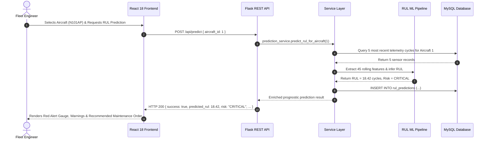

# AeroPredict - System Architecture & Engineering Design

This document details the software architecture, design patterns, tier interactions, and data flow of the **AeroPredict** predictive maintenance system.

---

## 1. Architectural Style & Design Principles

AeroPredict is designed as a **decoupled three-tier client-server architecture**:
1. **Presentation Tier:** Single-Page Application (SPA) built with React 18, Vite, and Tailwind CSS.
2. **Application & Prognostics Tier:** RESTful API service built with Python Flask, encapsulating business logic, connection pooling, and the scikit-learn Machine Learning inference pipeline.
3. **Persistence Tier:** Relational database management system built with MySQL 8.0 / MariaDB, enforcing strict ACID compliance and referential integrity.

```mermaid
flowchart TD
    subgraph ClientTier["Presentation Tier (Browser)"]
        UI["React 18 Single-Page Application"]
        Router["React Router v6"]
        Recharts["Recharts Telemetry Visualizer"]
        Axios["API Client (Axios + Error Interceptors)"]
        UI --> Router
        UI --> Recharts
        UI --> Axios
    end

    subgraph AppTier["Application Tier (Python Flask)"]
        Flask["Flask REST API Server (Port 5000)"]
        CORS["CORS Middleware"]
        Blueprints["Modular API Blueprints"]
        Services["Business Service Layer"]
        ML["Random Forest RUL Inference Pipeline"]
        
        Flask --> CORS
        Flask --> Blueprints
        Blueprints --> Services
        Services --> ML
    end

    subgraph DataTier["Persistence Tier (MySQL 8.0)"]
        Pool["PyMySQL Connection Pool"]
        DB[("aeropredict_db")]
        Pool --> DB
    end

    Axios <-->|HTTP / REST (JSON)| Flask
    Services <--> Pool
```

---

## 2. Core Architectural Design Patterns

### 2.1 Backend Design Patterns
- **Application Factory Pattern (`create_app()`):** Encapsulates Flask application creation, allowing environment-driven configuration for development, testing, and production modes.
- **Blueprint Pattern:** Separates routes into distinct domains (`aircraft`, `engine`, `prediction`, `maintenance`, `dashboard`, `health`), avoiding monolithic route handlers.
- **Service Layer Pattern:** Completely decouples HTTP routing from database operations. Blueprints only parse request parameters and serialize responses; services (`aircraft_service.py`, `prediction_service.py`, etc.) handle business rules and database transactions.
- **Connection Pooling:** PyMySQL connection pool maintains reusable database sockets, eliminating TCP handshake overhead on high-frequency sensor telemetry queries.
- **Parameterized SQL:** All queries strictly use parameterized tuples (`%s`) to eliminate SQL injection vulnerabilities.

### 2.2 Frontend Design Patterns
- **API Client Abstraction (`frontend/src/api/`):** Centralizes all HTTP communication in modular service clients (`aircraftApi.js`, `predictionApi.js`, etc.) with global interceptors for uniform error handling.
- **Composite Layout Pattern:** The application shell (`App.jsx`) uses persistent global navigation (`Sidebar.jsx`, `Header.jsx`) while dynamically swapping content views via React Router.
- **Error Boundary Pattern (`ErrorBoundary.jsx`):** Catches uncaught runtime JavaScript exceptions in child component trees and presents a clear fallback UI without crashing the entire single-page application.
- **Design System Tokens (`tailwind.config.js`):** Encapsulates an aviation-inspired dark palette (`slate-900`, `sky-500`, `amber-500`, `rose-600`) with consistent layout, typography, and card tokens.

---

## 3. Subsystem Breakdown & Interactions

### 3.1 Executive Dashboard Subsystem
- **Goal:** Provide real-time situational awareness for fleet operations engineers.
- **Interactions:** The `GET /api/dashboard` endpoint issues optimized aggregated queries against `aircraft` and `maintenance_records` tables, computing operational readiness percentages and active work orders without loading heavy raw sensor rows into memory.

### 3.2 Fleet Asset Management Subsystem
- **Goal:** Maintain aircraft asset profiles, accumulated flight hours, total elapsed engine cycles, and operating statuses (`OPERATIONAL`, `UNDER_MAINTENANCE`, `ATTENTION_REQUIRED`, `RETIRED`).
- **Interactions:** Linked directly via foreign key relationships to sensor logs, work orders, and prognostic predictions.

### 3.3 Engine Telemetry Subsystem
- **Goal:** Ingest and visualize 21-channel thermodynamic and mechanical sensor streams mapped from NASA C-MAPSS turbofan simulations.
- **Interactions:** Exposes time-series telemetry to the frontend Recharts module, rendering real-time degradation curves across compressor temperatures ($T_{30}$), turbine temperatures ($T_{50}$), and core rotational speeds ($N_c$).

### 3.4 Machine Learning Prognostics Subsystem
- **Goal:** Predict Remaining Useful Life (RUL) in operational cycles and assign actionable risk levels.
- **Interactions:** 
  1. Receives current cycle sensor vectors or looks up historical cycles for a target aircraft.
  2. Extracts rolling mean and standard deviation over a backward 5-cycle window.
  3. Feeds the 45-dimensional causal vector into the pre-trained Random Forest model.
  4. Returns the predicted RUL and prescribes standardized maintenance actions based on risk category (`LOW`, `MEDIUM`, `HIGH`, `CRITICAL`).

### 3.5 Maintenance Management Subsystem
- **Goal:** Track work order lifecycles from initial prognostic alert to technician sign-off.
- **Interactions:** Transitions work orders through statuses (`PENDING` $\rightarrow$ `IN_PROGRESS` $\rightarrow$ `COMPLETED`), maintaining an audit log with dates and technician notes.

---

## 4. End-to-End Operational Data Flow



---

## 5. Security & Reliability Strategy

- **Environment Isolation:** Database credentials and secrets are kept in `.env` (excluded from version control). Only `.env.example` is committed.
- **SQL Injection Prevention:** 100% of SQL statements across all backend services use `%s` query parameterization.
- **Cross-Origin Security:** CORS is strictly handled via `flask-cors` with whitelisted local developer origins.
- **Database Connection Resilience:** Connection pool handles transient disconnects and automatically refreshes stale sessions.
