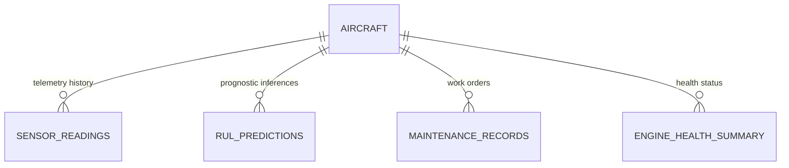

# AeroPredict - Database Design & Schema Specification

This document details the database architecture, schema definitions, relational constraints, and indexing strategy for the **AeroPredict** system.

---

## 1. Database Overview

- **Database Engine:** MySQL Server 8.0+ / MariaDB 10.6+
- **Default Database Name:** `aeropredict_db`
- **Character Set:** `utf8mb4`
- **Collation:** `utf8mb4_unicode_ci`
- **Storage Engine:** InnoDB (Supports ACID compliance, Foreign Key referential integrity, and row-level locking)
- **Connection Management:** PyMySQL connection pool (size=5, reset-on-return)

---

## 2. Relational Architecture & Tables

The schema is composed of five relational tables:



### 2.1 Table: `aircraft`
Stores operational assets in the commercial airline fleet.

| Column | Type | Constraints | Description |
| :--- | :--- | :--- | :--- |
| `id` | `INT` | `PRIMARY KEY AUTO_INCREMENT` | Unique system identifier |
| `tail_number` | `VARCHAR(20)` | `NOT NULL UNIQUE` | ICAO registration tail number (e.g. `N101AP`) |
| `model` | `VARCHAR(50)` | `NOT NULL` | Aircraft type (e.g. `Boeing 737-800`) |
| `manufacturer` | `VARCHAR(50)` | `NOT NULL` | OEM manufacturer (`Boeing`, `Airbus`, `Embraer`) |
| `manufacturing_year` | `INT` | `NULL` | Year of manufacture |
| `engine_type` | `VARCHAR(50)` | `NOT NULL` | Powerplant model (e.g. `CFM56-7B`, `GE90-115B`) |
| `cmapss_unit_id` | `INT` | `UNIQUE NULL` | Linked NASA C-MAPSS simulation unit ID (1–100) |
| `current_cycles` | `INT` | `NOT NULL DEFAULT 0` | Total operating flight cycles accumulated |
| `flight_hours` | `INT` | `NOT NULL DEFAULT 0` | Total airframe flight hours |
| `status` | `ENUM` | `NOT NULL DEFAULT 'OPERATIONAL'` | `OPERATIONAL`, `UNDER_MAINTENANCE`, `ATTENTION_REQUIRED`, `RETIRED` |
| `created_at` | `TIMESTAMP` | `DEFAULT CURRENT_TIMESTAMP` | Initial asset registration date |
| `updated_at` | `TIMESTAMP` | `DEFAULT CURRENT_TIMESTAMP ON UPDATE` | Last modification timestamp |

---

### 2.2 Table: `sensor_readings`
Stores time-series thermodynamic and mechanical telemetry channels mapped from NASA C-MAPSS.

| Column | Type | Constraints | Description | Baseline |
| :--- | :--- | :--- | :--- | :--- |
| `id` | `BIGINT` | `PRIMARY KEY AUTO_INCREMENT` | Telemetry record ID | — |
| `aircraft_id` | `INT` | `NOT NULL, FK -> aircraft(id)` | Linked aircraft asset | — |
| `cycle` | `INT` | `NOT NULL` | Engine operating flight cycle | — |
| `setting_1` | `DECIMAL(10,4)` | `NULL` | Flight Mach / Altitude Setting 1 | — |
| `setting_2` | `DECIMAL(10,4)` | `NULL` | Throttle Resolver Angle (TRA) Setting 2 | — |
| `setting_3` | `DECIMAL(10,4)` | `NULL` | Sea Level Operating Flag Setting 3 | 100.0 |
| `sensor_1` | `DECIMAL(12,4)` | `NULL` | Total temperature at fan inlet (T2) [°R] | 518.67 |
| `sensor_2` | `DECIMAL(12,4)` | `NULL` | Total temperature at LPC outlet (T24) [°R] | 642.0 |
| `sensor_3` | `DECIMAL(12,4)` | `NULL` | Total temperature at HPC outlet (T30) [°R] | 1589.0 |
| `sensor_4` | `DECIMAL(12,4)` | `NULL` | Total temperature at LPT outlet (T50) [°R] | 1400.0 |
| `sensor_5` | `DECIMAL(12,4)` | `NULL` | Total pressure at fan inlet (P2) [psia] | 14.62 |
| `sensor_6` | `DECIMAL(12,4)` | `NULL` | Total pressure in bypass-duct (P15) [psia] | 21.61 |
| `sensor_7` | `DECIMAL(12,4)` | `NULL` | Total pressure at HPC outlet (P30) [psia] | 554.0 |
| `sensor_8` | `DECIMAL(12,4)` | `NULL` | Physical fan speed (Nf) [rpm] | 2388.0 |
| `sensor_9` | `DECIMAL(12,4)` | `NULL` | Physical core speed (Nc) [rpm] | 9046.0 |
| `sensor_10`| `DECIMAL(12,4)` | `NULL` | Engine pressure ratio (epr) | 1.30 |
| `sensor_11`| `DECIMAL(12,4)` | `NULL` | Static pressure at HPC outlet (Ps30) [psia] | 47.5 |
| `sensor_12`| `DECIMAL(12,4)` | `NULL` | Fuel flow to static pressure ratio (phi) | 521.6 |
| `sensor_13`| `DECIMAL(12,4)` | `NULL` | Corrected fan speed (NRf) [rpm] | 2388.0 |
| `sensor_14`| `DECIMAL(12,4)` | `NULL` | Corrected core speed (NRc) [rpm] | 8138.0 |
| `sensor_15`| `DECIMAL(12,4)` | `NULL` | Bypass Ratio (BPR) | 8.42 |
| `sensor_16`| `DECIMAL(12,4)` | `NULL` | Burner fuel-air ratio (farB) | 0.03 |
| `sensor_17`| `DECIMAL(12,4)` | `NULL` | Bleed Enthalpy (htBleed) [Btu/lb] | 392.0 |
| `sensor_18`| `DECIMAL(12,4)` | `NULL` | Demanded fan speed (Nf_dmd) [rpm] | 2388.0 |
| `sensor_19`| `DECIMAL(12,4)` | `NULL` | Demanded corrected fan speed (PCNfR_dmd) | 100.0 |
| `sensor_20`| `DECIMAL(12,4)` | `NULL` | High-Pressure Turbine coolant bleed (W31) | 39.0 |
| `sensor_21`| `DECIMAL(12,4)` | `NULL` | Low-Pressure Turbine coolant bleed (W32) | 23.4 |
| `recorded_at`| `TIMESTAMP` | `DEFAULT CURRENT_TIMESTAMP` | Telemetry transmission timestamp | — |

---

### 2.3 Table: `rul_predictions`
Persists prognostic model inferences, risk levels, and maintenance prescriptions.

| Column | Type | Constraints | Description |
| :--- | :--- | :--- | :--- |
| `id` | `BIGINT` | `PRIMARY KEY AUTO_INCREMENT` | Prediction record ID |
| `aircraft_id` | `INT` | `NOT NULL, FK -> aircraft(id)` | Associated aircraft |
| `cycle` | `INT` | `NOT NULL` | Operating cycle at inference |
| `predicted_rul` | `DECIMAL(8,2)` | `NOT NULL` | Estimated remaining flight cycles |
| `risk_level` | `ENUM` | `NOT NULL` | `LOW`, `MEDIUM`, `HIGH`, `CRITICAL` |
| `recommendation`| `TEXT` | `NOT NULL` | Prescribed maintenance action plan |
| `predicted_at` | `TIMESTAMP` | `DEFAULT CURRENT_TIMESTAMP` | Timestamp of prediction generation |

---

### 2.4 Table: `maintenance_records`
Manages work orders, technicians' schedules, and maintenance histories.

| Column | Type | Constraints | Description |
| :--- | :--- | :--- | :--- |
| `id` | `INT` | `PRIMARY KEY AUTO_INCREMENT` | Work order ID |
| `aircraft_id` | `INT` | `NOT NULL, FK -> aircraft(id)` | Target aircraft |
| `title` | `VARCHAR(150)` | `NOT NULL` | Work order title / service name |
| `description` | `TEXT` | `NOT NULL` | Detailed maintenance scope |
| `priority` | `ENUM` | `NOT NULL DEFAULT 'MEDIUM'` | `LOW`, `MEDIUM`, `HIGH`, `CRITICAL` |
| `status` | `ENUM` | `NOT NULL DEFAULT 'PENDING'` | `PENDING`, `IN_PROGRESS`, `COMPLETED` |
| `scheduled_date` | `DATE` | `NULL` | Planned service date |
| `completed_date` | `DATE` | `NULL` | Actual completion date |
| `technician_notes`| `TEXT` | `NULL` | Inspector observations and sign-offs |
| `created_at` | `TIMESTAMP` | `DEFAULT CURRENT_TIMESTAMP` | Creation timestamp |
| `updated_at` | `TIMESTAMP` | `DEFAULT CURRENT_TIMESTAMP ON UPDATE` | Last modification timestamp |

---

### 2.5 Table: `engine_health_summary`
Aggregates subsystem health snapshots for high-speed dashboard analytics.

| Column | Type | Constraints | Description |
| :--- | :--- | :--- | :--- |
| `id` | `INT` | `PRIMARY KEY AUTO_INCREMENT` | Summary ID |
| `aircraft_id` | `INT` | `NOT NULL, FK -> aircraft(id)` | Target aircraft |
| `health_index` | `DECIMAL(5,2)` | `NOT NULL DEFAULT 100.00` | Composite health score (0–100%) |
| `primary_risk` | `VARCHAR(100)` | `NOT NULL DEFAULT 'Nominal'` | Identified component risk |
| `updated_at` | `TIMESTAMP` | `DEFAULT CURRENT_TIMESTAMP ON UPDATE` | Snapshot timestamp |

---

## 3. Database Constraints & Referential Integrity

- **Foreign Key Cascades:**
  - `sensor_readings.aircraft_id` -> `aircraft.id` (`ON DELETE CASCADE`)
  - `rul_predictions.aircraft_id` -> `aircraft.id` (`ON DELETE CASCADE`)
  - `maintenance_records.aircraft_id` -> `aircraft.id` (`ON DELETE CASCADE`)
  - `engine_health_summary.aircraft_id` -> `aircraft.id` (`ON DELETE CASCADE`)
- **Indexes:**
  - `aircraft(status)` for instantaneous fleet filtering.
  - `sensor_readings(aircraft_id, cycle DESC)` for real-time telemetry time-series retrieval.
  - `rul_predictions(aircraft_id, predicted_at DESC)` for chronological prognostic history.
  - `maintenance_records(status, priority)` for active backlog prioritization.

---

## 4. Production DDL Schema (`schema.sql`)

```sql
CREATE DATABASE IF NOT EXISTS `aeropredict_db`
CHARACTER SET utf8mb4
COLLATE utf8mb4_unicode_ci;

USE `aeropredict_db`;

-- 1. Aircraft Table
CREATE TABLE IF NOT EXISTS `aircraft` (
    `id` INT AUTO_INCREMENT PRIMARY KEY,
    `tail_number` VARCHAR(20) NOT NULL UNIQUE,
    `model` VARCHAR(50) NOT NULL,
    `manufacturer` VARCHAR(50) NOT NULL,
    `manufacturing_year` INT NULL,
    `engine_type` VARCHAR(50) NOT NULL,
    `cmapss_unit_id` INT UNIQUE NULL,
    `current_cycles` INT NOT NULL DEFAULT 0,
    `flight_hours` INT NOT NULL DEFAULT 0,
    `status` ENUM('OPERATIONAL', 'UNDER_MAINTENANCE', 'ATTENTION_REQUIRED', 'RETIRED') NOT NULL DEFAULT 'OPERATIONAL',
    `created_at` TIMESTAMP NOT NULL DEFAULT CURRENT_TIMESTAMP,
    `updated_at` TIMESTAMP NOT NULL DEFAULT CURRENT_TIMESTAMP ON UPDATE CURRENT_TIMESTAMP,
    INDEX `idx_aircraft_status` (`status`)
) ENGINE=InnoDB;

-- 2. Sensor Readings Table
CREATE TABLE IF NOT EXISTS `sensor_readings` (
    `id` BIGINT AUTO_INCREMENT PRIMARY KEY,
    `aircraft_id` INT NOT NULL,
    `cycle` INT NOT NULL,
    `setting_1` DECIMAL(10,4) NULL,
    `setting_2` DECIMAL(10,4) NULL,
    `setting_3` DECIMAL(10,4) NULL,
    `sensor_1` DECIMAL(12,4) NULL,
    `sensor_2` DECIMAL(12,4) NULL,
    `sensor_3` DECIMAL(12,4) NULL,
    `sensor_4` DECIMAL(12,4) NULL,
    `sensor_5` DECIMAL(12,4) NULL,
    `sensor_6` DECIMAL(12,4) NULL,
    `sensor_7` DECIMAL(12,4) NULL,
    `sensor_8` DECIMAL(12,4) NULL,
    `sensor_9` DECIMAL(12,4) NULL,
    `sensor_10` DECIMAL(12,4) NULL,
    `sensor_11` DECIMAL(12,4) NULL,
    `sensor_12` DECIMAL(12,4) NULL,
    `sensor_13` DECIMAL(12,4) NULL,
    `sensor_14` DECIMAL(12,4) NULL,
    `sensor_15` DECIMAL(12,4) NULL,
    `sensor_16` DECIMAL(12,4) NULL,
    `sensor_17` DECIMAL(12,4) NULL,
    `sensor_18` DECIMAL(12,4) NULL,
    `sensor_19` DECIMAL(12,4) NULL,
    `sensor_20` DECIMAL(12,4) NULL,
    `sensor_21` DECIMAL(12,4) NULL,
    `recorded_at` TIMESTAMP NOT NULL DEFAULT CURRENT_TIMESTAMP,
    FOREIGN KEY (`aircraft_id`) REFERENCES `aircraft`(`id`) ON DELETE CASCADE,
    UNIQUE KEY `uk_aircraft_cycle` (`aircraft_id`, `cycle`),
    INDEX `idx_sensor_aircraft_cycle` (`aircraft_id`, `cycle` DESC)
) ENGINE=InnoDB;

-- 3. Maintenance Records Table
CREATE TABLE IF NOT EXISTS `maintenance_records` (
    `id` INT AUTO_INCREMENT PRIMARY KEY,
    `aircraft_id` INT NOT NULL,
    `title` VARCHAR(150) NOT NULL,
    `description` TEXT NOT NULL,
    `priority` ENUM('LOW', 'MEDIUM', 'HIGH', 'CRITICAL') NOT NULL DEFAULT 'MEDIUM',
    `status` ENUM('PENDING', 'IN_PROGRESS', 'COMPLETED') NOT NULL DEFAULT 'PENDING',
    `scheduled_date` DATE NULL,
    `completed_date` DATE NULL,
    `technician_notes` TEXT NULL,
    `created_at` TIMESTAMP NOT NULL DEFAULT CURRENT_TIMESTAMP,
    `updated_at` TIMESTAMP NOT NULL DEFAULT CURRENT_TIMESTAMP ON UPDATE CURRENT_TIMESTAMP,
    FOREIGN KEY (`aircraft_id`) REFERENCES `aircraft`(`id`) ON DELETE CASCADE,
    INDEX `idx_maintenance_aircraft_status` (`aircraft_id`, `status`),
    INDEX `idx_maintenance_status_priority` (`status`, `priority`)
) ENGINE=InnoDB;

-- 4. RUL Predictions Table
CREATE TABLE IF NOT EXISTS `rul_predictions` (
    `id` BIGINT AUTO_INCREMENT PRIMARY KEY,
    `aircraft_id` INT NOT NULL,
    `cycle` INT NOT NULL,
    `predicted_rul` DECIMAL(8,2) NOT NULL,
    `risk_level` ENUM('LOW', 'MEDIUM', 'HIGH', 'CRITICAL') NOT NULL,
    `recommendation` TEXT NOT NULL,
    `predicted_at` TIMESTAMP NOT NULL DEFAULT CURRENT_TIMESTAMP,
    FOREIGN KEY (`aircraft_id`) REFERENCES `aircraft`(`id`) ON DELETE CASCADE,
    INDEX `idx_prediction_aircraft_time` (`aircraft_id`, `predicted_at` DESC)
) ENGINE=InnoDB;

-- 5. Engine Health Summary Table
CREATE TABLE IF NOT EXISTS `engine_health_summary` (
    `id` INT AUTO_INCREMENT PRIMARY KEY,
    `aircraft_id` INT NOT NULL UNIQUE,
    `health_index` DECIMAL(5,2) NOT NULL DEFAULT 100.00,
    `primary_risk` VARCHAR(100) NOT NULL DEFAULT 'Nominal',
    `updated_at` TIMESTAMP NOT NULL DEFAULT CURRENT_TIMESTAMP ON UPDATE CURRENT_TIMESTAMP,
    FOREIGN KEY (`aircraft_id`) REFERENCES `aircraft`(`id`) ON DELETE CASCADE
) ENGINE=InnoDB;
```
