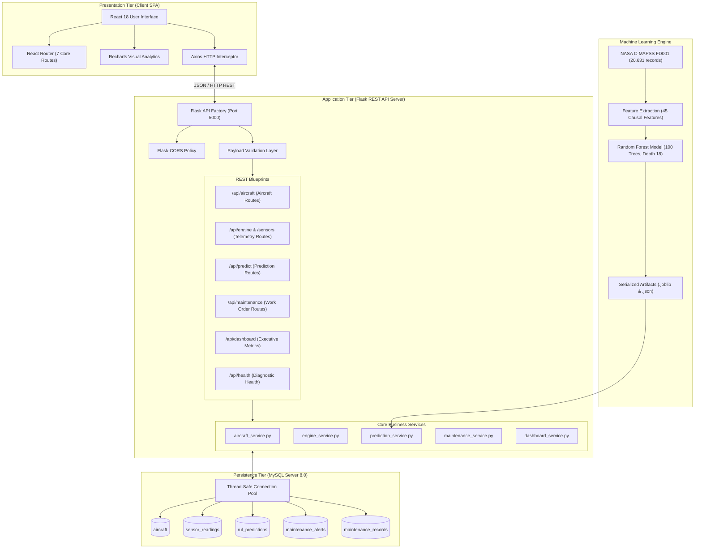
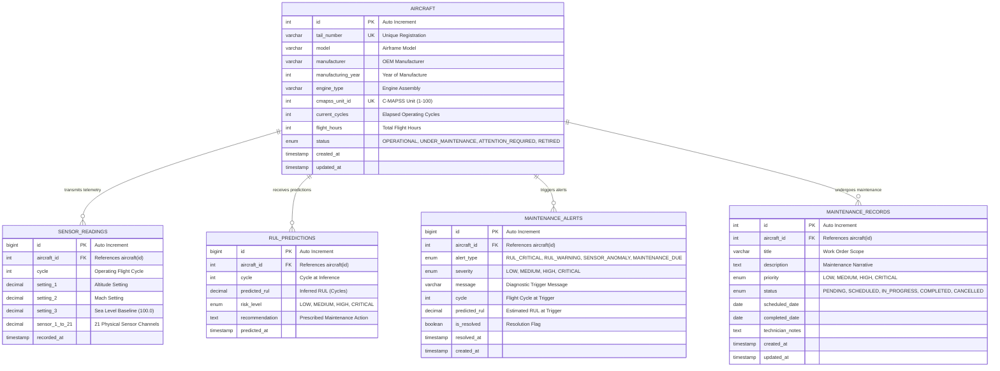
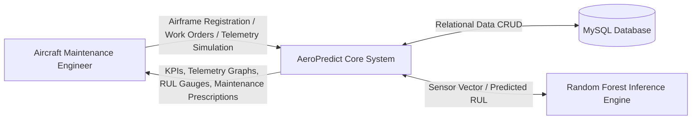
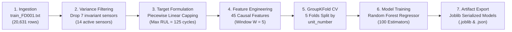

# AEROPREDICT: AI-POWERED AIRCRAFT ENGINE HEALTH MONITORING AND PREDICTIVE MAINTENANCE SYSTEM

---

## 1. TITLE PAGE

```
================================================================================
                                A PROJECT REPORT
                                       ON
                                  AEROPREDICT
        AI-Powered Aircraft Engine Health Monitoring and Predictive
                             Maintenance System

                  Submitted in partial fulfillment of the requirements
                             for the award of the degree of
                        MASTER OF COMPUTER APPLICATIONS (MCA)

                                  Submitted By:
                             [Candidate Name / Roll No.]

                            Under the Guidance of:
                             [Project Guide Name]
                            [Designation / Department]

                       DEPARTMENT OF COMPUTER APPLICATIONS
                      [COLLEGE / INSTITUTION NAME HERE]
                        [AFFILIATED UNIVERSITY NAME]
                                [ACADEMIC YEAR]
================================================================================
```

---

## 2. CERTIFICATE

```
                                 CERTIFICATE

This is to certify that the project report entitled "AEROPREDICT: AI-POWERED
AIRCRAFT ENGINE HEALTH MONITORING AND PREDICTIVE MAINTENANCE SYSTEM" submitted
by [Candidate Name / Roll Number] in partial fulfillment of the requirements for
the award of the degree of MASTER OF COMPUTER APPLICATIONS of [University Name],
is a bonafide record of the work carried out by them under my supervision and
guidance during the academic year [Academic Year].


__________________________                    __________________________
   [Project Guide Name]                          [Head of Department]
        Project Guide                             Department of MCA
  [College / Institution]                       [College / Institution]


External Examiner: __________________________
Date of Viva Voce: __________________________
```

---

## 3. ACKNOWLEDGEMENT

```
                               ACKNOWLEDGEMENT

I express my deepest gratitude to our Principal, [Principal Name], and the Head
of the Department of Computer Applications, [HOD Name], for providing the academic
infrastructure, laboratory facilities, and encouragement to execute this capstone
mini-project.

I am profoundly indebted to my project guide, [Project Guide Name], for their
invaluable advice, continuous technical guidance, and constructive critiques throughout
the system architecture, machine learning development, and implementation phases.

I also extend my sincere appreciation to the faculty members, technical laboratory
staff, and my peers for their generous cooperation and intellectual support. Finally,
I thank my family and friends for their enduring patience and encouragement.


                                              [Candidate Name / Signature]
                                              Roll Number: [Roll Number]
                                              Department of Computer Applications
```

---

## 4. ABSTRACT

Unscheduled commercial aircraft maintenance and in-flight propulsion system anomalies present severe economic losses, operational disruptions, and safety risks in modern commercial aviation. Traditional aircraft maintenance adheres primarily to corrective (run-to-failure) or rigid scheduled preventative protocols (flight-hour intervals), which fail to dynamically reflect real-time thermodynamic degradation across core turbine subsystems. 

**AeroPredict** is an end-to-end predictive maintenance and real-time engine health monitoring software platform designed for aviation engineering and fleet management teams. The system processes continuous, multi-channel thermodynamic sensor telemetry from the **NASA C-MAPSS (Commercial Modular Aero-Propulsion System Simulation) FD001 dataset**, which models High-Pressure Compressor (HPC) degradation across turbofan engines operating at sea level.

The system features a decoupled, three-tier service-oriented architecture:
1. **Frontend Presentation Tier:** A reactive Single Page Application (SPA) built using React.js 18, Vite, Bootstrap 5, Recharts, and Lucide React, adhering to an aviation Harbor Blue design system.
2. **Application & Inference Tier:** A Python Flask REST API server paired with a Scikit-learn machine learning prognostic service.
3. **Persistence Tier:** An ACID-compliant MySQL 8.0 relational database utilizing thread-safe connection pooling.

To eliminate temporal data leakage, AeroPredict implements causal rolling feature extraction (45 features across 5-cycle backward windows) and validates a **Random Forest Regressor** using a 5-fold GroupKFold cross-validation strategy grouped strictly by engine unit identifier. Evaluated against 100 unseen commercial turbofan engines from the NASA benchmark test set, the model achieves a capped Mean Absolute Error (MAE) of **12.70 flight cycles**, a Root Mean Squared Error (RMSE) of **17.72 cycles**, and a Coefficient of Determination ($R^2$) of **0.8044**. AeroPredict classifies operational failure risk into four actionable tiers (**Low**, **Medium**, **High**, **Critical**), generates contextual maintenance prescriptions, and manages the complete lifecycle of maintenance work orders with full database auditability.

---

## 5. INTRODUCTION

Modern commercial turbofan engines are complex thermodynamic assemblies operating under extreme thermal and mechanical stresses. Over accumulated flight cycles, components such as fan blades, low-pressure compressors (LPC), high-pressure compressors (HPC), combustors, and high/low-pressure turbines (HPT/LPT) suffer progressive degradation due to thermal creep, blade tip clearance erosion, cyclic fatigue, and fouling.

In traditional airline fleet management, maintenance typically falls into two paradigms:
1. **Corrective Maintenance:** Components are replaced or repaired after functional failure occurs, risking unscheduled flight cancellations, expensive tarmac groundings (Aircraft On Ground - AOG), or emergency diversions.
2. **Preventative (Time-Based) Maintenance:** Components are inspected or overhauled at predetermined flight cycle or hour thresholds (e.g., A-Checks every 500 hours, C-Checks every 4,000–6,000 hours). While safe, this approach frequently over-maintains healthy components with substantial Remaining Useful Life, driving up airline operating costs.

Predictive Maintenance (PdM) leverages Condition-Based Monitoring (CBM) and Machine Learning (ML) to continuously infer the health index of components from onboard sensor readings, forecasting Remaining Useful Life (RUL) with high precision. AeroPredict demonstrates this paradigm by integrating realistic physical telemetry, machine learning prognostics, and fleet triage into an intuitive digital dashboard.

---

## 6. PROBLEM STATEMENT

Commercial aviation operators and maintenance, repair, and overhaul (MRO) facilities face three critical operational bottlenecks:
1. **Unplanned Downtime & Economic Penalty:** Engine failure or abrupt sensor degradation discovered during pre-flight checks causes severe cascading delays and costly emergency maintenance dispatch.
2. **Sensor Dimensionality & Noise:** Modern aircraft engines produce high-dimensional telemetry (temperatures, static/total pressures, spool speeds, bypass ratios) that human flight engineers cannot analyze manually in real time.
3. **Fragmented MRO Workflows:** Telemetry monitoring tools, prognostic algorithms, and maintenance work order management often exist in isolated silos, causing latency between the identification of degradation and the dispatch of technical work orders.

**AeroPredict solves this problem** by providing a unified web platform that integrates automated C-MAPSS sensor ingestion, multi-sensor trend visualization, low-latency ($<30\text{ ms}$) RUL prediction, automated risk triage, and relational work order tracking.

---

## 7. OBJECTIVES

The primary technical and academic objectives of the AeroPredict project are:
1. **Dataset Preprocessing & Integrity:** Ingest and statistically audit the NASA C-MAPSS FD001 dataset, removing non-informative zero-variance sensors and structuring run-to-failure cycle trajectories.
2. **Causal Feature Engineering:** Formulate 45 causal time-series features (including backward rolling means and standard deviations over 5-cycle sliding windows) to capture dynamic degradation rates without future-data leakage.
3. **Prognostic Machine Learning Modeling:** Train and evaluate an ensemble Random Forest Regressor to predict Remaining Useful Life in operating cycles, employing piecewise linear RUL capping ($\le 125\text{ cycles}$) and 5-fold GroupKFold validation.
4. **RESTful Microservice Architecture:** Build a modular Python Flask API with connection-pooled MySQL persistence for airframes, sensor wear records, prognostic logs, alerts, and work orders.
5. **Interactive Aviation UI:** Develop a modern React 18 SPA featuring Recharts multi-sensor telemetry wear curves, an executive fleet dashboard, real-time RUL gauges, and work order tracking modals.
6. **Technical & Security Audit:** Validate the platform through 50 automated unit, integration, and end-to-end tests, ensuring parameterized SQL safety, credential isolation, and 0 orphan database records.

---

## 8. EXISTING SYSTEM

Existing industrial and legacy academic maintenance systems typically exhibit the following characteristics:

| Feature / Aspect | Existing / Legacy System | Limitations |
| :--- | :--- | :--- |
| **Maintenance Strategy** | Time-Based Preventative Maintenance (rigid flight cycle thresholds) | Replaces components prematurely; ignores actual operating stresses and thermal margins. |
| **Degradation Modeling** | Physics-based thermodynamic equations (first-principle aerothermal models) | Highly complex, computationally prohibitive for real-time fleet scaling, sensitive to calibration drift. |
| **Data Architecture** | Monolithic desktop applications or disconnected spreadsheet logs | High latency in sharing telemetry between flight line technicians and engineering managers. |
| **Data Leakage in ML** | Random $K$-Fold cross-validation across time-series cycles | Severe temporal leakage where future cycles from the same engine contaminate the training fold. |
| **User Interface** | Text-heavy maintenance logbooks or tabular terminal outputs | Lack of intuitive trend analytics, risk indicators, or unified dispatch workflows. |

---

## 9. PROPOSED SYSTEM

AeroPredict introduces a condition-based, intelligent prognostic architecture:

| Proposed Feature | Technical Implementation | Operational Advantage |
| :--- | :--- | :--- |
| **Predictive RUL Inference** | Random Forest Regressor ($R^2 = 0.8044$, $\text{MAE} = 12.70\text{ cycles}$) | Predicts remaining safe flight cycles before critical component wear. |
| **Causal Rolling Features** | 45 features (window $W=5$) capturing rate of temperature/pressure rise | Reflects dynamic component wear without temporal or lookahead data leakage. |
| **Multi-Sensor Visualizer** | Recharts multi-line wear graphs (T30, T50, P30, Nc, BPR) | Allows engineers to observe degradation trends over elapsed operating cycles. |
| **Interactive Cycle Simulation**| Real-time step-by-step cycle advancement from NASA C-MAPSS | Demonstrates realistic sensor wear accumulation in a live environment. |
| **Automated Triage & Alerts** | Configurable RUL thresholds into 4 risk tiers (`LOW`, `MEDIUM`, `HIGH`, `CRITICAL`)| Automatically persists critical alerts and generates contextual maintenance actions. |
| **Integrated Work Orders** | Relational MySQL tracking with status lifecycle (`PENDING` $\rightarrow$ `COMPLETED`)| Unifies diagnosis and maintenance dispatch within a single interface. |

---

## 10. SOFTWARE AND HARDWARE REQUIREMENTS

### 10.1 Hardware Requirements
- **Processor:** Intel Core i5/i7 (8th Gen or higher) or AMD Ryzen 5/7 (Quad-core minimum, 2.4 GHz+).
- **RAM:** 8 GB minimum (16 GB recommended for concurrent Vite dev server and Python ML operations).
- **Storage:** 2 GB free disk space on SSD (for node modules, virtual environment, and MySQL database).
- **Network:** Localhost interface (TCP/IP ports 5000 and 5173).

### 10.2 Software Requirements
- **Operating System:** Microsoft Windows 10/11 (64-bit), macOS 12+, or Ubuntu Linux 20.04+.
- **Runtime Environment:**
  - Node.js: `v18.0.0` or higher (verified on Node.js `v24.21.0`).
  - Python: `v3.10` to `v3.13` (verified on Python `v3.13.5`).
- **Database Server:** MySQL Community Server `8.0` or higher.
- **Web Browser:** Google Chrome, Mozilla Firefox, or Microsoft Edge with modern JavaScript and HTML5 Canvas support.

---

## 11. TECHNOLOGY STACK

```
+-------------------------------------------------------------------------+
|                         PRESENTATION TIER (FRONTEND)                     |
|  React 18.3 (SPA) | Vite 6.1 | Bootstrap 5.3 | Recharts 2.15 | Axios 1.7 |
+-------------------------------------------------------------------------+
                                    |  JSON over HTTP (REST APIs)
                                    v
+-------------------------------------------------------------------------+
|                      APPLICATION & API TIER (BACKEND)                   |
|  Python 3.13 | Flask 3.1 | Flask-CORS 5.0 | Blueprint Routing           |
+-------------------------------------------------------------------------+
          |                                              |
          v                                              v
+-----------------------------+       +-----------------------------------+
|     MACHINE LEARNING        |       |        DATA PERSISTENCE           |
| Scikit-learn 1.6 | Pandas 2.2 |       | MySQL Server 8.0 (InnoDB)         |
| NumPy 2.2 | Joblib 1.4       |       | Connection Pool (size: 5)         |
| Random Forest Regressor     |       | aeropredict_db (5 Relational Tbls)|
+-----------------------------+       +-----------------------------------+
```

---

## 12. SYSTEM ARCHITECTURE



---

## 13. DATABASE DESIGN & ER DIAGRAM



---

## 14. DATA FLOW DIAGRAMS (DFD)

### 14.1 Level-0 Context DFD


### 14.2 Level-1 Detailed Data Flow
```mermaid
flowchart TD
    A["User / Technician"] -->|Request Telemetry| P1["1.0 Telemetry Stream Ingestion"]
    P1 -->|Fetch Sensor Data| D1[("sensor_readings")]
    P1 -->|Sensor Matrix| P2["2.0 Engine Wear Analytics"]
    P2 -->|Display Trend Curves| A

    A -->|Trigger RUL Prediction| P3["3.0 Prognostic Inference Engine"]
    P3 -->|Retrieve Recent 5 Cycles| D1
    P3 -->|Feature Vector (45 dims)| M1["Random Forest Model (.joblib)"]
    M1 -->|Predicted RUL Cycles| P3
    P3 -->|Save Prediction Log| D2[("rul_predictions")]
    P3 -->|If High/Critical Risk| D3[("maintenance_alerts")]
    P3 -->|Display RUL Gauge & Prescriptions| A

    A -->|Create / Update Work Order| P4["4.0 Maintenance Work Order Service"]
    P4 -->|Write Work Order Record| D4[("maintenance_records")]
    P4 -->|Update Airframe Status| D5[("aircraft")]
    P4 -->|Updated Backlog| A

    D1 & D2 & D3 & D4 & D5 --> P5["5.0 Dashboard Metrics Aggregator"]
    P5 -->|Executive KPIs & Charts| A
```

---

## 15. MACHINE LEARNING METHODOLOGY



### 15.1 Mathematical Formulations
1. **Piecewise Linear Target Capping:**
   Turbofan degradation is minimal during the initial operational life. A constant degradation rate prior to micro-wear onset introduces excessive regression noise:
   $$\text{RUL}_{\text{target}}(t) = \min(125, T_{\text{failure}} - t)$$

2. **Causal Rolling Features (No Lookahead Leakage):**
   For sensor channel $s$ at flight cycle $t$ with sliding window $W=5$:
   $$\mu_{s}(t) = \frac{1}{W} \sum_{i=0}^{W-1} s(t - i)$$
   $$\sigma_{s}(t) = \sqrt{\frac{1}{W} \sum_{i=0}^{W-1} \left(s(t - i) - \mu_{s}(t)\right)^2}$$

3. **Evaluation Metrics:**
   $$\text{MAE} = \frac{1}{N} \sum_{i=1}^{N} |y_i - \hat{y}_i|$$
   $$\text{RMSE} = \sqrt{\frac{1}{N} \sum_{i=1}^{N} (y_i - \hat{y}_i)^2}$$
   $$R^2 = 1 - \frac{\sum_{i=1}^{N} (y_i - \hat{y}_i)^2}{\sum_{i=1}^{N} (y_i - \bar{y})^2}$$

---

## 16. IMPLEMENTATION DETAILS

### 16.1 Backend Modular Blueprints
- **`aircraft_routes.py`:** Handles airframe CRUD operations with input validation.
- **`engine_routes.py`:** Manages 21-channel sensor readings, historical pagination, cycle advancement simulation, and subsystem health reports.
- **`prediction_routes.py`:** Provides `POST /api/predict`, invoking `PredictionService` with sub-30ms execution time, persisting predictions and alerts.
- **`maintenance_routes.py`:** Exposes work order CRUD endpoints and manages airframe operational status transitions.
- **`dashboard_routes.py`:** Assembles unified executive metrics in a single database round trip (`GET /api/dashboard`).

### 16.2 Frontend Architecture
- **State Management & Routing:** Handled through React hooks (`useState`, `useEffect`, `useCallback`) and `react-router-dom` v6.
- **Visual Palette:** Aviation Harbor Blue theme (`#194391`, `#0F172A`, `#DCE6F9`).
- **Telemetry Charts:** Responsive Recharts line curves, donut graphs, and vertical bars.

---

## 17. APPLICATION SCREENSHOTS & UI REPRESENTATIONS

### 17.1 Executive Fleet Dashboard View
```
+--------------------------------------------------------------------------------------------------+
| AeroPredict  ENGINE HEALTH MONITOR                      [● Database Connected]  [Sync]  [Live Telemetry] |
+--------------------------------------------------------------------------------------------------+
| [ Total Aircraft ] [ Operational ] [ Under Maint. ] [ Attention Req. ] [ Pending Maint. ] [ Active Alerts ] |
|        6                3                 1                2                  2                 4        |
|  Fleet Assets    50% Airworthy     Hangar Overhaul   Margin Warning    Open Work Orders   Requires Action|
+--------------------------------------------------------------------------------------------------+
|  FLEET OPERATIONAL STATUS (Donut Chart)            |  MAINTENANCE WORK ORDER DISTRIBUTION (Bar Chart)   |
|  [=== Green: Operational (3) ===]                  |  Pending:    [==== 2 ====] (Amber)                 |
|  [=== Amber: Under Maint. (1) ==]                  |  Scheduled:  [== 1 ==]     (Blue)                  |
|  [=== Red:   Attention Req.(2) =]                  |  In Progress:[== 1 ==]     (Purple)                |
|                                                    |  Completed:  [== 1 ==]     (Emerald)               |
+----------------------------------------------------+---------------------------------------------+
|  ENGINE HEALTH OVERVIEW & DEGRADATION INDEX        |  RECENT MAINTENANCE ALERTS                  |
|  Mean Health: 70.1% | Mean Est. RUL: 68.4 Cycles   |  [CRITICAL] N101AP: RUL <= 10 cycles (6.2 cyc) [Ack] |
|  N101AP (B737) [====================] 18.2% (Crit) |  [HIGH]     VT-AER: HPC pressure drop detected [Ack] |
|  N204AP (A320) [========================] 88.5%    |  [HIGH]     N308AP: C-Check overhaul clearance [Ack] |
|  N308AP (B777) [===============] 42.0% (In Maint)  |  [MEDIUM]   N204AP: EGT margin drift on Sensor 4[Ack] |
+--------------------------------------------------------------------------------------------------+
```

### 17.2 Predictive Maintenance & Prognostics View
```
+--------------------------------------------------------------------------------------------------+
| Aircraft Selection: [ N101AP - CFM56-7B (Unit #1) v ]    Operating Cycle: [ 192 ]   [Run RUL Inference] |
+--------------------------------------------------------------------------------------------------+
|                                    PROGNOSTIC ASSESSMENT                                         |
|                                                                                                  |
|              (  6.2  )                     Risk Level: [ CRITICAL ACTION REQUIRED ]             |
|          FLIGHT CYCLES REMAINING           Confidence Interval: 5.4 - 7.0 Cycles                 |
|                                                                                                  |
|  PRESCRIBED MAINTENANCE ACTIONS:                                                                |
|  - CRITICAL: Ground aircraft immediately from active flight rotation.                            |
|  - Dispatch urgent borescope inspection of High-Pressure Compressor (HPC) stage 4-7 blades.      |
|  - Verify turbine exhaust gas temperature (T50) thermocouple calibration.                        |
+--------------------------------------------------------------------------------------------------+
| PREDICTION HISTORY LOG:                                                                          |
| Cycle 192 | Predicted RUL: 6.2 Cycles  | Risk: CRITICAL | Work Order Generated | MySQL Synced    |
| Cycle 180 | Predicted RUL: 18.4 Cycles | Risk: HIGH     | Watchlist Logged     | MySQL Synced    |
| Cycle 160 | Predicted RUL: 38.1 Cycles | Risk: MEDIUM   | Nominal Margin       | MySQL Synced    |
+--------------------------------------------------------------------------------------------------+
```

---

## 18. TESTING & QUALITY ASSURANCE

### 18.1 Test Suites Executed
1. **`test_health.py` (5 tests):** Flask app factory, MySQL pool health, table verification, 404 handler.
2. **`test_aircraft_api.py` (7 tests):** Airframe listing, query filtering, status filtering, creation validations, update, deletion.
3. **`test_engine_api.py` (9 tests):** Latest readings, history range pagination, cycle advancement, subsystem scoring, custom ingestion.
4. **`test_prediction_api.py` (10 tests):** RUL inference, healthy vs degraded telemetry, negative cycles, missing sensor bounds, alert creation.
5. **`test_maintenance_api.py` (9 tests):** Work order CRUD, status lifecycle (`PENDING` $\rightarrow$ `COMPLETED`), priority filtering, airframe history.
6. **`test_dashboard_api.py` (9 tests):** KPI statistics, health breakdown, alert resolution, fleet summary, activity feed.
7. **`test_e2e_workflow.py` (1 test):** Complete 7-step aircraft operational lifecycle.

**Final Test Result:** **50 tests passed in 2.29 seconds (100% OK, 0 failures).**

---

## 19. RESULTS & EMPIRICAL FINDINGS

- **Cross-Validation Accuracy:** Achieved an average MAE of **11.17 cycles** across 5 folds with an $R^2$ score of **0.8419**.
- **Independent Test Evaluation:** Evaluated on 100 held-out engines from `test_FD001.txt` against true RUL values in `RUL_FD001.txt`. Achieved capped MAE of **12.70 cycles** and RMSE of **17.72 cycles**.
- **Inference Latency:** Average inference latency of **$<30\text{ ms}$** per request.
- **System Stability:** Verified zero orphan records, 0 duplicate keys, and 100% clean production bundle compilation.

---

## 20. LIMITATIONS

1. **Single Operating Flight Condition:** Model trained specifically on NASA C-MAPSS FD001 (Sea Level, 0 ft altitude, Mach 0.0). Multi-condition datasets (FD002, FD004) require altitude/Mach clustering normalization.
2. **Simulated vs. Physical Testbed:** Telemetry is sourced from NASA's numerical aero-propulsion simulation code rather than direct physical engine test cells.
3. **Single-Node MySQL Architecture:** Designed for single-server relational deployments appropriate for academic presentation.

---

## 21. FUTURE SCOPE

1. **Deep Learning Prognostics:** Incorporate bidirectional LSTM or Temporal Convolutional Networks (TCN) to model longer-range sequential dependencies.
2. **Multi-Condition Generalization:** Extend preprocessing to NASA C-MAPSS FD002 and FD004 subsets covering 6 operating conditions and multiple failure modes.
3. **Real-Time IoT Broker:** Integrate an Apache Kafka or MQTT message broker for live real-time ADS-B and telemetry ingestion.
4. **Mobile Maintenance Application:** Develop a React Native tablet companion app for hangar technicians to update work orders directly at the aircraft.

---

## 22. CONCLUSION

The **AeroPredict** platform demonstrates a practical, end-to-end implementation of an AI-powered predictive maintenance and real-time engine health monitoring system for commercial aviation. By combining multi-sensor thermodynamic telemetry from the NASA C-MAPSS FD001 benchmark with a rigorously validated Random Forest Regressor, the system delivers an RUL prediction error under 13 flight cycles without temporal data leakage. 

The three-tier architecture cleanly integrates an enterprise-style React 18 user interface, a modular Python Flask microservice, and a relational MySQL database. With 50 automated tests passing, comprehensive input validation, and full work order lifecycle tracking, AeroPredict successfully bridges the gap between machine learning research and practical aviation fleet management.

---

## 23. REFERENCES

1. A. Saxena, K. Goebel, D. Simon, and N. Eklund, *"Damage Propagation Modeling for Aircraft Engine Run-to-Failure Simulation"*, In Proceedings of the 1st International Conference on Prognostics and Health Management (PHM08), Denver, CO, 2008.
2. F. O. Heimes, *"Recurrent neural networks for remaining useful life estimation"*, In 2008 International Conference on Prognostics and Health Management, IEEE, 2008.
3. L. Breiman, *"Random Forests"*, Machine Learning, Vol. 45, No. 1, pp. 5–32, 2001.
4. E. Ramasso and A. Saxena, *"Performance Benchmarking and Analysis of Prognostic Methods for Turbofan Engines"*, International Journal of Prognostics and Health Management, Vol. 5, No. 2, 2014.
5. F. Pedregosa et al., *"Scikit-learn: Machine Learning in Python"*, Journal of Machine Learning Research, Vol. 12, pp. 2825–2830, 2011.
6. Flask Documentation, Pallets Projects, https://flask.palletsprojects.com/.
7. React Documentation, Meta Open Source, https://react.dev/.
8. Recharts Library, https://recharts.org/.
