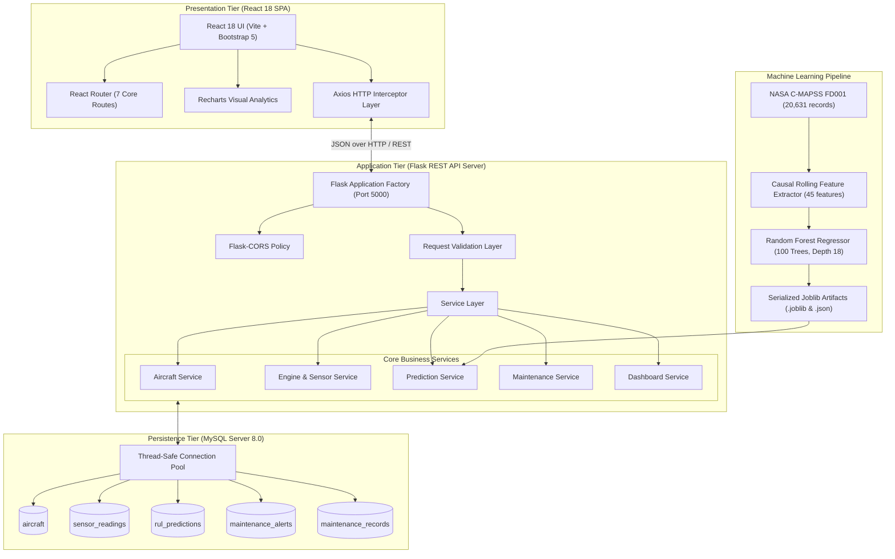
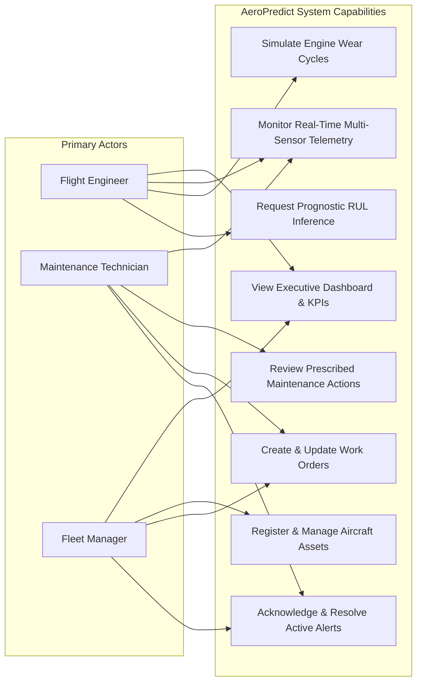
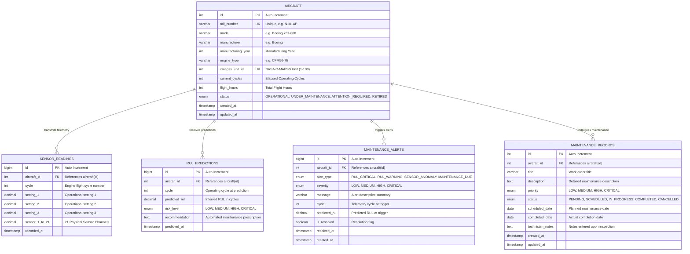
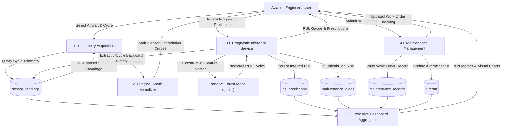
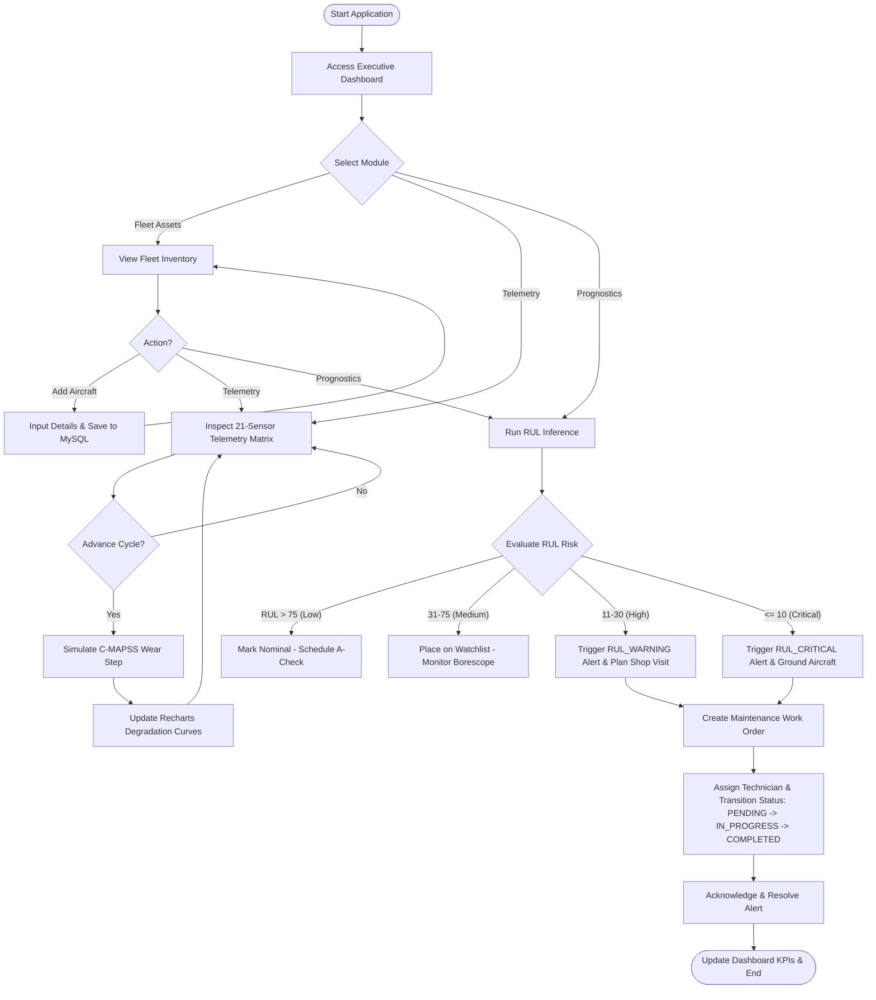
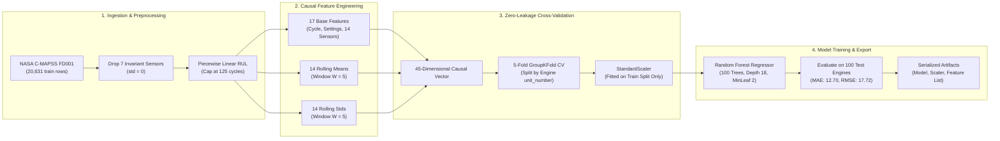

# AeroPredict - Comprehensive Architectural Diagrams

This document collects all official UML and structural diagrams for the **AeroPredict** platform, formatted in standard Mermaid syntax.

---

## 1. System Architecture Diagram

---

## 2. Use Case Diagram

---

## 3. Entity-Relationship (ER) Diagram

---

## 4. Data Flow Diagram (DFD Level-1)

---

## 5. Activity Diagram (Operational Lifecycle)

---

## 6. Machine Learning Workflow Diagram

